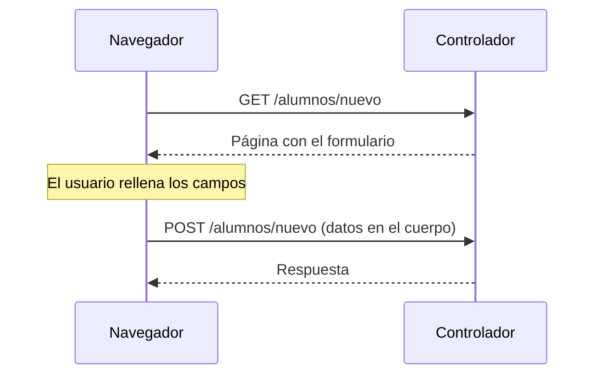

# 1. GET y POST en los formularios

Un formulario es la forma en que el usuario envía información al servidor. Antes de ver cómo
trabaja Spring con ellos, hay que entender cómo viajan esos datos por la red, porque de eso depende
qué método HTTP usar y cómo recibirlos en el controlador.

## 1.1. Qué hace un formulario HTML

Cuando el usuario pulsa el botón de envío, el navegador recoge los campos del formulario y genera
una petición HTTP. Dos atributos de la etiqueta `<form>` controlan cómo se hace:

| Atributo | Qué indica | Valor por defecto |
|---|---|---|
| `action` | La ruta a la que se envía la petición | La URL de la página actual |
| `method` | El método HTTP: `get` o `post` | `get` |

```html
<form action="/alumnos/resultados" method="get">
    <input type="text" name="nombre">
    <button type="submit">Buscar</button>
</form>
```

En una plantilla Thymeleaf, la ruta de `action` se escribe con `th:action="@{...}"`, igual que los
enlaces de la Unidad 2.

## 1.2. Atributos de un input: `name` y `value`

Cada control del formulario (`<input>`, `<select>`, `<textarea>`) aporta a la petición un **par
`clave=valor`**. Dos atributos deciden cuál es ese par: `name` es la clave y `value` es el valor.

### `name`: la clave del dato

- Es el nombre con el que el dato **llega al servidor**. En Spring, es el que se busca con
  `@RequestParam`: el `name` del campo y el nombre del parámetro del método tienen que coincidir.
- Un campo **sin `name` no se envía**, aunque el usuario haya escrito algo en él.
- No es lo mismo que `id`. El `id` sirve para enlazar una `<label>`, para aplicar CSS o para
  localizar el elemento con JavaScript; el navegador **no** lo envía.

```html
<input type="text" id="campoNombre" name="nombre">
```

Aquí el dato viaja como `nombre=...`. El `id="campoNombre"` no aparece en la petición.

:::warning
Si el nombre no coincide, el servidor responde con un error.
Con `<input name="nombreAlumno">` y un método `guardar(@RequestParam String nombre)`, el parámetro
`nombre` nunca llega, y Spring responde con un error **400** (*Required request parameter 'nombre'
is not present*). Es un fallo muy habitual: ante un 400 en un formulario, lo primero que hay que
revisar es que los `name` del HTML coinciden con los nombres de los parámetros.
:::

### `value`: el valor que se envía

Según el tipo de control, `value` significa algo ligeramente distinto:

| Control | Qué hace `value` | Qué se envía |
|---|---|---|
| `text`, `email`, `number`, `date`... | Es el **valor inicial** que aparece escrito en el campo | Lo que haya en el campo al enviar, que puede ser lo que escribió el usuario |
| `radio` | Es el valor de **esa opción** | El `value` de la opción marcada |
| `checkbox` | Es el valor de **esa casilla** | Su `value`, **solo si está marcada** |
| `<option>` de un `<select>` | Es el valor de **esa opción** | El `value` de la opción elegida |
| `hidden` | Es el valor fijo del campo oculto | Siempre su `value` |

El texto que ve el usuario y el `value` que se envía son cosas distintas: en
`<option value="2DAW">Segundo de DAW</option>` se envía `2DAW`, no el texto visible.

```html
<form th:action="@{/alumnos/nuevo}" method="post">
    <input type="text" name="nombre" value="Lucía">

    <input type="radio" name="curso" value="1DAW"> Primero de DAW
    <input type="radio" name="curso" value="2DAW" checked> Segundo de DAW

    <select name="turno">
        <option value="manana">Mañana</option>
        <option value="tarde">Tarde</option>
    </select>

    <input type="checkbox" name="delegado" value="si"> Delegado

    <input type="hidden" name="origen" value="web">
    <button type="submit">Guardar</button>
</form>
```

Si el usuario deja el nombre como está, elige "Tarde" y marca la casilla, se envía:

```text
nombre=Lucía&curso=2DAW&turno=tarde&delegado=si&origen=web
```

(El navegador codifica la tilde como `%C3%AD`; aquí se muestra descodificado para que sea legible.)

Hay tres detalles que dan problemas con frecuencia:

- **Los botones de radio de un mismo grupo comparten `name`**. Es lo que hace que solo se pueda
  marcar uno, y que se envíe un único valor. Si no se marca ninguno, no se envía nada para ese
  nombre.
- **Una casilla sin marcar no se envía**: el parámetro no llega al servidor, ni como `false` ni
  como vacío. Una casilla marcada **sin `value`** envía el texto `on`.
- **Varios campos con el mismo `name`** (por ejemplo, un grupo de casillas) envían varios valores
  para esa clave: `aficion=cine&aficion=musica`. En el controlador se recogen en una lista
  (`@RequestParam List<String> aficion`).

### Otros atributos con efecto sobre el envío

La mayoría de atributos de un `<input>` ya se vieron en las páginas de formularios y validación de
HTML. Estos son los que afectan a **si el dato se envía**:

| Atributo | Efecto en el envío |
|---|---|
| `type` | Decide el tipo de control y el formato del dato |
| `disabled` | El campo **no se envía** |
| `readonly` | El usuario no puede editarlo, pero el campo **sí se envía** |
| `type="hidden"` | No se ve, pero se envía; sirve para mandar datos que el usuario no edita (más adelante, el `id` de lo que se está editando) |
| `required` | El navegador impide enviar el formulario si está vacío |

:::note
`disabled` frente a `readonly`
Si se quiere mostrar un dato que el usuario no puede cambiar pero que el servidor sí debe recibir,
hay que usar `readonly`, no `disabled`.
:::

## 1.3. El método GET

Con `GET`, el navegador añade los datos del formulario a la URL como **parámetros de *query
string***, justo lo que ya vimos con `@RequestParam` en la página de controladores.

```text
GET /alumnos/resultados?nombre=Lucia&curso=2DAW HTTP/1.1
Host: localhost:8080
```

Características:

- Los datos **van en la URL**: se ven en la barra de direcciones.
- Quedan en el historial del navegador y en los registros (*logs*) del servidor.
- Se puede guardar la URL como marcador o compartirla, y llevará consigo los datos.
- Existe un límite práctico de longitud de la URL (varía según navegador y servidor).
- Es un método **seguro e idempotente** (visto en la página de métodos de petición HTTP): repetir la
  petición, o recargar la página, no tiene ningún efecto sobre el servidor.

Por todo ello, `GET` se usa para **consultar** información: búsquedas, filtros, paginación,
ordenación.

## 1.4. El método POST

Con `POST`, los datos viajan en el **cuerpo** de la petición, no en la URL.

```text
POST /alumnos/nuevo HTTP/1.1
Host: localhost:8080
Content-Type: application/x-www-form-urlencoded

nombre=Luc%C3%ADa+M%C3%A1rquez&curso=2DAW
```

El cuerpo usa por defecto el formato `application/x-www-form-urlencoded`: pares `clave=valor`
separados por `&`, donde los espacios se codifican como `+` y los caracteres especiales (como las
tildes) como `%` seguido de su código. Spring lo descodifica automáticamente.

Características:

- Los datos **no aparecen en la URL**, ni quedan en el historial.
- No hay un límite práctico de tamaño.
- No se puede guardar como marcador: la URL por sí sola no lleva los datos.
- **No es idempotente**: repetir la petición puede provocar efectos repetidos (por ejemplo, crear
  dos alumnos iguales). Por eso, si el usuario recarga una página que se obtuvo con `POST`, el
  navegador le pregunta si quiere reenviar el formulario. En la página de *Post/Redirect/Get* de
  esta unidad veremos cómo evitar ese problema.

Por todo ello, `POST` se usa para **enviar datos que modifican algo** en el servidor (crear un
alumno, registrar un usuario, enviar un pedido) y para datos que no conviene que aparezcan en la URL.

:::note
Que no se vea en la URL no significa que esté protegido
Los datos de un `POST` no están cifrados por el hecho de ir en el cuerpo: quien intercepte la
comunicación puede leerlos. Lo que protege la información es usar **HTTPS**, tanto con `GET` como
con `POST`.
:::

Cuando el formulario incluye archivos, se necesita además `enctype="multipart/form-data"`; lo
dejamos para más adelante.

## 1.5. Comparativa

| | `GET` | `POST` |
|---|---|---|
| Dónde viajan los datos | En la URL (*query string*) | En el cuerpo de la petición |
| ¿Visibles en la URL? | Sí | No |
| Límite de tamaño | Sí, la longitud de la URL | No práctico |
| ¿Se puede guardar como marcador? | Sí | No |
| ¿Idempotente? | Sí | No |
| ¿Recargar es inocuo? | Sí | No, el navegador pide confirmación |
| Uso típico | Consultar: búsquedas, filtros | Modificar: altas, registros, envíos |

Regla práctica: si el formulario **solo consulta**, `GET`; si **crea o cambia algo**, `POST`.

## 1.6. GET y POST en Spring

Un formulario necesita normalmente **dos rutas**: una que **muestra** el formulario (siempre por
`GET`, porque es una consulta) y otra que **recibe** los datos enviados. Con `POST`, ambas pueden
compartir la misma ruta, distinguiéndose solo por el método:



Para recibir los datos se usa `@RequestParam`, igual que con la *query string*: Spring busca el
parámetro por su nombre, venga de la URL (`GET`) o del cuerpo (`POST`).

### Ejemplo 1: formulario de búsqueda con `GET`

```java
@Controller
@RequestMapping("/alumnos")
public class AlumnosController {

    @GetMapping("/buscar")
    public String formularioBusqueda() {
        return "busqueda"; // templates/busqueda.html
    }

    @GetMapping("/resultados")
    @ResponseBody
    public String resultados(@RequestParam String nombre,
                             @RequestParam(defaultValue = "todos") String curso) {
        return "Buscando '" + nombre + "' en el curso " + curso;
    }
}
```

```html title="templates/busqueda.html"
<form th:action="@{/alumnos/resultados}" method="get">
    <label>Nombre: <input type="text" name="nombre"></label>
    <label>Curso:
        <select name="curso">
            <option value="todos">Todos</option>
            <option value="1DAW">1DAW</option>
            <option value="2DAW">2DAW</option>
        </select>
    </label>
    <button type="submit">Buscar</button>
</form>
```

Al enviar el formulario con "Lucia" y "2DAW", el navegador pasa a la URL:

```text
http://localhost:8080/alumnos/resultados?nombre=Lucia&curso=2DAW
```

Los datos son visibles en la barra de direcciones, y se podría guardar o compartir esa URL.

### Ejemplo 2: formulario de alta con `POST`

```java
@Controller
@RequestMapping("/alumnos")
public class AlumnosController {

    @GetMapping("/nuevo")
    public String formularioAlta() {
        return "alta"; // templates/alta.html
    }

    @PostMapping("/nuevo")
    @ResponseBody
    public String guardar(@RequestParam String nombre, @RequestParam String curso) {
        return "Alumno recibido: " + nombre + " (" + curso + ")";
    }
}
```

```html title="templates/alta.html"
<form th:action="@{/alumnos/nuevo}" method="post">
    <label>Nombre: <input type="text" name="nombre"></label>
    <label>Curso: <input type="text" name="curso"></label>
    <button type="submit">Guardar</button>
</form>
```

La ruta `/alumnos/nuevo` tiene dos métodos distintos: el `GET` muestra el formulario y el `POST`
lo recibe. Al enviarlo, la URL del navegador sigue siendo `/alumnos/nuevo`, sin ningún dato visible.

### Error habitual: `405 Method Not Allowed`

Si el método del formulario no coincide con el que tiene la ruta mapeada, el servidor responde con
un error **405**:

- Un formulario con `method="post"` enviado a una ruta que solo tiene `@GetMapping`.
- Escribir en la barra de direcciones la URL de una ruta que solo tiene `@PostMapping`: al
  escribir una URL, el navegador siempre hace una petición `GET`.

## 1.7. Comprobarlo en el navegador

Las herramientas para desarrolladores (tecla `F12`) permiten ver exactamente qué envía el
navegador:

1. Abre la pestaña **Red** (*Network*).
2. Envía el formulario.
3. Pulsa sobre la petición que aparece en la lista.
4. En **Cabeceras** verás el método y la URL; en **Carga útil** (*Payload*) verás los datos
   enviados, ya sean los parámetros de la URL o el cuerpo del `POST`.

Repetir la prueba con los dos ejemplos de la sección anterior es la mejor forma de ver la
diferencia en la práctica.

## 1.8. Solo `GET` y `POST`

Los formularios HTML únicamente admiten `GET` y `POST` en su atributo `method`. Aunque en la
página de controladores mencionamos `@PutMapping` y `@DeleteMapping`, un formulario no puede
enviar esos métodos directamente. Por eso, en esta unidad las operaciones que modifican o borran
datos (editar, eliminar) se harán con `POST`, usando rutas distintas para cada acción
(`/alumnos/{id}/editar`, `/alumnos/{id}/eliminar`).