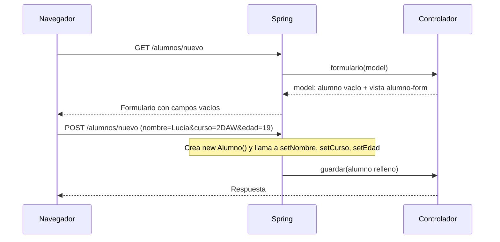

# 2. Enlazar el formulario con un objeto

En la página anterior recogíamos los datos de un formulario con un `@RequestParam` por cada campo.
Funciona bien con dos campos, pero un formulario real tiene ocho o diez. En esta página vemos cómo
Spring puede rellenar un objeto entero con los datos del formulario, y cómo Thymeleaf se engancha a
ese mismo objeto para generar los campos. A este mecanismo se le llama **binding** (enlace de datos).

## 2.1. El problema de `@RequestParam` en formularios grandes

Con `@RequestParam`, cada campo del formulario es un parámetro del método:

```java
@PostMapping("/nuevo")
@ResponseBody
public String guardar(@RequestParam String nombre,
                      @RequestParam String curso,
                      @RequestParam Integer edad,
                      @RequestParam String email,
                      @RequestParam String telefono) {
    return "Alumno recibido: " + nombre;
}
```

Los inconvenientes se acumulan según crece el formulario:

- La firma del método se vuelve interminable.
- Cada dato que se quiera usar después (en un servicio, en otra vista) hay que pasarlo suelto.
- Para mostrar el formulario ya relleno (por ejemplo, al editar) habría que enviar cada valor al
  modelo por separado y repetirlo en cada campo de la plantilla.

La alternativa es agrupar todos los campos en **un objeto** y dejar que Spring lo rellene.

## 2.2. La clase del formulario

Para que Spring pueda rellenar un objeto con los datos de la petición, la clase necesita:

- Un **constructor sin argumentos**, para que Spring pueda crear la instancia vacía.
- Un **método *setter*** por cada campo del formulario, con el que Spring asigna los valores.
- Los *getters*, que usa Thymeleaf para leer los valores.

```java
package es.centro.miproyecto.models;

public class Alumno {

    private String nombre;
    private String curso;
    private Integer edad;

    public Alumno() { }

    public String getNombre() { return nombre; }
    public void setNombre(String nombre) { this.nombre = nombre; }

    public String getCurso() { return curso; }
    public void setCurso(String curso) { this.curso = curso; }

    public Integer getEdad() { return edad; }
    public void setEdad(Integer edad) { this.edad = edad; }
}
```

:::note
Diferencia con la clase `Alumno` de la Unidad 2
La clase `Alumno` que usamos para mostrar datos solo tenía un constructor con parámetros y
*getters*, porque nunca se modificaba. Para un formulario hace falta añadir el constructor vacío y
los *setters*. Fíjate también en que `edad` es `Integer` y no `int`: un campo de texto vacío se
convierte en `null`, algo que un `int` primitivo no admite.
:::

## 2.3. `th:object` y `th:field`

En la plantilla, dos atributos conectan el formulario con el objeto:

- **`th:object`**, en la etiqueta `<form>`, indica qué objeto del modelo representa el formulario
  completo. Es la misma `th:object` que vimos en las expresiones de selección: dentro del
  formulario se pueden usar expresiones `*{...}` que se refieren a ese objeto.
- **`th:field`**, en cada campo, lo enlaza con una propiedad del objeto.

```html title="templates/alumno-form.html"
<form th:action="@{/alumnos/nuevo}" th:object="${alumno}" method="post">
    <label for="nombre">Nombre:</label>
    <input type="text" th:field="*{nombre}">

    <label for="curso">Curso:</label>
    <input type="text" th:field="*{curso}">

    <label for="edad">Edad:</label>
    <input type="number" th:field="*{edad}">

    <button type="submit">Guardar</button>
</form>
```

### Qué genera `th:field`

`th:field="*{nombre}"` es una abreviatura que Thymeleaf expande a los tres atributos que ya
conocemos de la página anterior:

| Atributo | Valor generado | Para qué sirve |
|---|---|---|
| `name` | `nombre` | La clave con la que viajará el dato; Spring la usará para buscar el *setter* |
| `id` | `nombre` | Permite enlazar la `<label for="nombre">` |
| `value` | El valor actual de `alumno.nombre` | Rellena el campo con lo que ya tiene el objeto |

Con un objeto vacío, el HTML que recibe el navegador es parecido a:

```html
<input type="text" id="nombre" name="nombre" value="">
```

Y si el objeto ya tuviera datos (`alumno.nombre` igual a `"Lucía"`), el campo aparecería relleno:

```html
<input type="text" id="nombre" name="nombre" value="Lucía">
```

Esta precarga es lo que permitirá, más adelante, reutilizar el mismo formulario para **editar**.

## 2.4. El controlador: `GET` con un objeto vacío, `POST` con `@ModelAttribute`

```java
@Controller
@RequestMapping("/alumnos")
public class AlumnosController {

    @GetMapping("/nuevo")
    public String formulario(Model model) {
        model.addAttribute("alumno", new Alumno());
        return "alumno-form";
    }

    @PostMapping("/nuevo")
    @ResponseBody
    public String guardar(@ModelAttribute Alumno alumno) {
        return "Alumno recibido: " + alumno.getNombre()
                + ", curso " + alumno.getCurso()
                + ", edad " + alumno.getEdad();
    }
}
```

### El `GET` envía un objeto vacío

`th:object="${alumno}"` necesita que exista un objeto llamado `alumno` en el modelo cuando se
renderiza la plantilla. Por eso el método que muestra el formulario crea un `new Alumno()` y lo
añade al modelo, aunque no tenga ningún dato todavía.

:::note
Error habitual
Si el `GET` no añade el objeto al modelo, la plantilla falla con un error parecido a
`Neither BindingResult nor plain target object for bean name 'alumno' available as request
attribute`. Casi siempre significa que se ha olvidado el `model.addAttribute` o que la clave no
coincide con el nombre usado en `th:object`.
:::

### El `POST` recibe el objeto relleno

`@ModelAttribute` le indica a Spring que construya el objeto a partir de los datos de la petición.
El proceso, paso a paso:



Spring empareja cada parámetro de la petición con una propiedad del objeto **por nombre**:
`nombre` con `setNombre`, `curso` con `setCurso`, y así sucesivamente. Además, convierte los textos
al tipo de cada propiedad: el `"19"` que llega en la petición se convierte a `Integer` para
`setEdad`.

:::note
`@ModelAttribute` y el nombre en el modelo
Por defecto, el objeto recibido se añade también al modelo con el nombre de la clase en minúscula
inicial (`Alumno` pasa a `alumno`). Si quisiéramos otro nombre, se indica en la anotación:
`@ModelAttribute("alumno")`. Para tipos propios como `Alumno`, la anotación se puede omitir y
Spring hace lo mismo, pero en esta unidad la escribiremos siempre, para que se vea de dónde sale el
objeto.
:::

## 2.5. Cuando el nombre no coincide

Si en el formulario hay un campo cuyo `name` no corresponde a ninguna propiedad del objeto, Spring
lo **ignora sin avisar**: no hay ningún error. Con `th:field` esto no debería ocurrir, porque el
`name` se genera a partir de la propiedad, pero sí puede pasar con campos escritos a mano.

Compara este comportamiento con `@RequestParam`, que respondía con un error 400 si faltaba un
parámetro: con el binding, un nombre mal escrito deja simplemente la propiedad a `null`, y el fallo
suele pasar desapercibido hasta que se intenta usar el dato.

## 2.6. `@RequestParam` frente a `@ModelAttribute`

| | `@RequestParam` | `@ModelAttribute` |
|---|---|---|
| Qué recibe | Un dato suelto | Un objeto con todos los campos |
| Adecuado para | Formularios con uno o dos campos, filtros y búsquedas | Formularios de alta y edición |
| Si el dato no llega | Error 400 (si es obligatorio) | La propiedad queda a `null` |
| Conversión de tipos | Sí | Sí, propiedad a propiedad |
| Precarga del formulario | Manual | Automática con `th:field` |

Como regla práctica, los formularios de **búsqueda** (con `GET`) se resuelven bien con
`@RequestParam`, y los de **alta o edición** (con `POST`) se resuelven con `@ModelAttribute`.

## 2.7. ¿Entidad o clase específica del formulario?

En los ejemplos hemos usado la misma clase `Alumno` para el formulario y para representar al alumno
en el resto de la aplicación. Mientras el formulario tenga exactamente los mismos campos que la
clase, funciona bien.

Conviene crear una **clase específica para el formulario** cuando:

- El formulario tiene campos que no existen en la entidad (por ejemplo, "repetir contraseña").
- La entidad tiene campos que el usuario **no debería poder modificar** (un `id`, un rol, un
  importe calculado).

El segundo caso es una cuestión de seguridad: Spring rellena **cualquier propiedad** cuyo nombre
llegue en la petición, aunque el formulario HTML no tenga ese campo. Un usuario que envíe a mano
`id=1` o `admin=true` conseguiría asignar esos valores si el objeto los tiene.

```java
public class AlumnoForm {

    private String nombre;
    private String curso;
    private Integer edad;

    // constructor vacío, getters y setters
}
```

El controlador recibe el `AlumnoForm` y es el servicio quien lo convierte en `Alumno`, copiando
solo los campos que se permiten. En esta unidad, mientras no haya `id` ni datos sensibles,
seguiremos usando `Alumno` directamente; lo importante es tener presente el riesgo.
