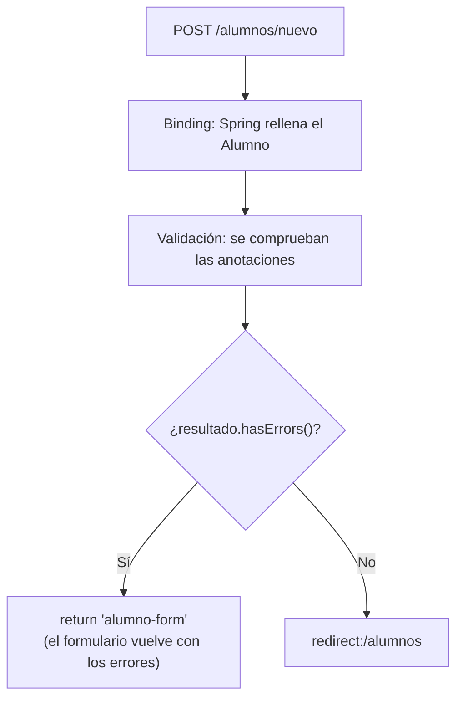

# 3. Validación en el servidor

Hasta ahora, el controlador daba por buenos todos los datos que le llegaban del formulario. En una
aplicación real eso no es posible: el usuario puede dejar campos vacíos, escribir una edad de 300
años o un email sin arroba. En esta página vemos cómo comprobar los datos en el servidor y cómo
devolver al usuario el formulario con los errores señalados.

## 3.1. Por qué validar en el servidor

Los formularios html ya cuentan con algunas herramientas de validación en el cliente: atributos como `required`,
`min`, `maxlength` o `pattern`. Es cómoda para el usuario, porque le avisa al instante, pero **no es
suficiente**:

- Cualquiera puede saltársela: basta con abrir las herramientas del navegador y borrar el atributo
  `required`, o enviar la petición con otro programa que ni siquiera use un navegador.
- Solo protege los formularios de nuestra web, no el servidor en sí.

Por eso se distinguen dos niveles, que se usan **a la vez**:

| | Validación del navegador (HTML) | Validación del servidor (Spring) |
|---|---|---|
| Dónde se ejecuta | En el navegador del usuario | En el servidor |
| Para qué sirve | Comodidad: avisa sin esperar a la respuesta | Garantía: los datos incorrectos no entran |
| ¿Se puede saltar? | Sí | No |
| ¿Es obligatoria? | No | **Sí** |

:::note
Para probar la validación del servidor
Mientras pruebas los ejemplos de esta página, añade el atributo `novalidate` a la etiqueta `<form>`.
Así el navegador no bloquea el envío con sus propias comprobaciones, y la petición llega al
servidor aunque los datos sean incorrectos. Cuando termines, quítalo.
:::

## 3.2. La dependencia

Spring valida los datos con **Bean Validation**, un estándar de Java (implementado por Hibernate
Validator) en el que las reglas se escriben como anotaciones sobre los campos de la clase. Para usarlo,
Spring Boot necesita su *starter*, que **no** viene incluido con el de web. En el `pom.xml`:

```xml
<dependency>
    <groupId>org.springframework.boot</groupId>
    <artifactId>spring-boot-starter-validation</artifactId>
</dependency>
```

Si al crear el proyecto con Spring Initializr marcaste la dependencia **Validation**, ya está añadida.

## 3.3. Anotaciones de validación

Las reglas se escriben directamente sobre los atributos de la clase del formulario:

```java
package es.centro.miproyecto.models;

import jakarta.validation.constraints.Email;
import jakarta.validation.constraints.Max;
import jakarta.validation.constraints.Min;
import jakarta.validation.constraints.NotBlank;
import jakarta.validation.constraints.NotNull;
import jakarta.validation.constraints.Size;

public class Alumno {

    @NotBlank(message = "El nombre es obligatorio")
    @Size(min = 2, max = 50, message = "El nombre debe tener entre 2 y 50 caracteres")
    private String nombre;

    @NotBlank(message = "Debes elegir un curso")
    private String curso;

    @NotNull(message = "La edad es obligatoria")
    @Min(value = 16, message = "La edad mínima es 16 años")
    @Max(value = 99, message = "La edad máxima es 99 años")
    private Integer edad;

    @NotBlank(message = "El email es obligatorio")
    @Email(message = "El email no tiene un formato válido")
    private String email;

    // constructor vacío, getters y setters, como en la página anterior
}
```

:::note
`jakarta.validation` o `javax.validation`
Con Spring Boot 3 las anotaciones están en el paquete `jakarta.validation.constraints`. En
proyectos con Spring Boot 2 o anteriores, el paquete era `javax.validation.constraints`. Si copias
código de internet y no compila, es lo primero que hay que revisar.
:::

### Anotaciones más habituales

| Anotación | Qué comprueba | Se aplica a |
|---|---|---|
| `@NotNull` | El valor no es `null` | Cualquier tipo |
| `@NotEmpty` | No es `null` ni está vacío | Texto, colecciones |
| `@NotBlank` | No es `null`, ni vacío, ni solo espacios | Texto |
| `@Size(min, max)` | Longitud del texto o tamaño de la colección | Texto, colecciones |
| `@Min(valor)` / `@Max(valor)` | Valor numérico mínimo / máximo | Números |
| `@Positive` | Número mayor que cero | Números |
| `@Email` | Formato de dirección de correo | Texto |
| `@Pattern(regexp = "...")` | Coincide con una expresión regular | Texto |
| `@Past` / `@Future` | Fecha anterior / posterior a hoy | Fechas |

### `@NotNull`, `@NotEmpty` y `@NotBlank`

Las tres exigen que el campo tenga valor, pero con distinto rigor. Esta tabla muestra si cada valor
**pasa** la validación:

| Valor del campo | `@NotNull` | `@NotEmpty` | `@NotBlank` |
|---|:---:|:---:|:---:|
| `null` | ❌ | ❌ | ❌ |
| `""` (vacío) | ✅ | ❌ | ❌ |
| `"   "` (solo espacios) | ✅ | ✅ | ❌ |
| `"Lucía"` | ✅ | ✅ | ✅ |

Para campos de texto obligatorios, `@NotBlank` es la opción habitual. Para números y fechas, que no
pueden ser una cadena vacía, se usa `@NotNull`.

:::note
Casi todas las anotaciones aceptan `null`
`@Size`, `@Min`, `@Max`, `@Email`, `@Pattern` o `@Past` consideran **válido** un valor `null`: solo
comprueban el valor cuando existe. Por eso, para un campo obligatorio hay que combinarlas con
`@NotNull` o `@NotBlank`, como en el ejemplo de la clase `Alumno`.
:::

Las expresiones regulares de `@Pattern` son las mismas que se usan en el atributo `pattern` de
HTML, y en ambos casos la expresión debe coincidir con el valor **completo**:

```java
@Pattern(regexp = "[0-9]{9}", message = "El teléfono debe tener 9 dígitos")
private String telefono;
```

## 3.4. `@Valid` y `BindingResult` en el controlador

Escribir las anotaciones en la clase no basta: hay que pedirle a Spring que las compruebe. En el
método que recibe el formulario se añaden dos cosas:

- **`@Valid`** delante del objeto: le indica a Spring que valide ese objeto después del *binding*.
- **`BindingResult`** como parámetro **inmediatamente después** del objeto: recoge el resultado,
  con todos los errores encontrados.

```java
@Controller
@RequestMapping("/alumnos")
public class AlumnosController {

    @GetMapping("/nuevo")
    public String formulario(Model model) {
        model.addAttribute("alumno", new Alumno());
        return "alumno-form";
    }

    @PostMapping("/nuevo")
    public String guardar(@Valid @ModelAttribute("alumno") Alumno alumno,
                          BindingResult resultado) {

        if (resultado.hasErrors()) {
            return "alumno-form"; // se vuelve a mostrar el formulario, con los errores
        }

        // aquí se llamaría al servicio para guardar el alumno
        return "redirect:/alumnos";
    }
}
```

El recorrido de la petición queda así:



Dos detalles importantes:

- **Si hay errores, se devuelve la vista directamente (`return "alumno-form"`), no una
  redirección.** Con `redirect:` se haría una petición nueva y los errores y los datos escritos
  se perderían.
- **`BindingResult` debe ir justo detrás del objeto validado.** Si falta, o hay otro parámetro entre
  medias, Spring no puede dárselo al método: en lugar de rellenarlo, lanza una excepción y el
  usuario recibe un error **400** (*Bad Request*), sin llegar a ver el formulario.

## 3.5. Mostrar los errores en la plantilla

Cuando el controlador vuelve a mostrar `alumno-form`, el objeto `alumno` (con lo que escribió el
usuario) y el resultado de la validación están disponibles para la plantilla. Thymeleaf ofrece
herramientas para usarlos, que funcionan dentro de un formulario con `th:object`:

| Herramienta | Qué hace |
|---|---|
| `${#fields.hasErrors('nombre')}` | `true` si el campo `nombre` tiene algún error |
| `th:errors="*{nombre}"` | Sustituye el contenido de la etiqueta por el mensaje de error del campo (si hay varios, los separa con `<br />`) |
| `th:errorclass="clase"` | Añade esa clase CSS al campo solo cuando tiene errores |
| `${#fields.hasErrors('*')}` | `true` si el formulario tiene algún error, en cualquier campo |
| `${#fields.errors('*')}` | Lista con todos los mensajes de error |

```html title="templates/alumno-form.html"
<form th:action="@{/alumnos/nuevo}" th:object="${alumno}" method="post" novalidate>

    <div>
        <label for="nombre">Nombre:</label>
        <input type="text" th:field="*{nombre}" th:errorclass="campo-error">
        <span class="mensaje-error" th:if="${#fields.hasErrors('nombre')}"
              th:errors="*{nombre}">Error</span>
    </div>

    <div>
        <label for="edad">Edad:</label>
        <input type="number" th:field="*{edad}" th:errorclass="campo-error">
        <span class="mensaje-error" th:if="${#fields.hasErrors('edad')}"
              th:errors="*{edad}">Error</span>
    </div>

    <button type="submit">Guardar</button>
</form>
```

Y un poco de CSS para que los errores se vean:

```css
.campo-error { border: 2px solid #c0392b; }
.mensaje-error { color: #c0392b; font-size: 0.9em; }
```

También se puede mostrar un resumen con todos los errores en la parte superior del formulario:

```html
<ul th:if="${#fields.hasErrors('*')}">
    <li th:each="error : ${#fields.errors('*')}" th:text="${error}">Error</li>
</ul>
```

### Conservar lo que el usuario había escrito

Al volver a mostrar el formulario, los campos aparecen **rellenos con lo que el usuario había
escrito**, sin que tengamos que hacer nada. Es el efecto de `th:field`, que toma el valor de
`alumno` (el objeto que Spring rellenó con la petición, aunque tuviera errores). Para que funcione,
el nombre del objeto en el modelo (`"alumno"`) debe coincidir con el de `th:object`: por eso
escribimos `@ModelAttribute("alumno")` en el `POST`.

## 3.6. Cuando el texto no se puede convertir al tipo del campo

Hay un tipo de error que no viene de ninguna anotación. Todo lo que llega en una petición son
textos, y Spring tiene que convertirlos al tipo de cada propiedad: `"19"` a `Integer`, `"2005-03-10"`
a `LocalDate`... Si la conversión es imposible (por ejemplo, el usuario escribe `"abc"` en la
edad), se produce un **error de conversión** (*type mismatch*).

### Qué ocurre

1. Spring intenta asignar el valor y falla; la propiedad se queda como estaba (`null` en un objeto
   nuevo).
2. Se registra un error en `BindingResult` para ese campo, con el código `typeMismatch`.
3. Como cualquier otro error, `resultado.hasErrors()` es `true` y se puede mostrar con
   `th:errors`. Si el campo ya tiene un error de conversión, Spring no añade además los errores
   de las anotaciones de ese mismo campo.
4. Si el método **no** tiene `BindingResult`, no se llega a ejecutar: el usuario recibe un
   error **400**.

Un `<input type="number">` impide escribir letras en el navegador, por lo que para provocar este
error en las pruebas hay que cambiarlo temporalmente a `type="text"`, o enviar la petición a mano.

### Casos habituales

| Campo | Texto recibido | Resultado |
|---|---|---|
| `Integer` | `"abc"` | Error de conversión |
| `Integer` | `"3.5"` | Error de conversión (no es un entero) |
| `Integer` | `""` (vacío) | **Sin error**: se convierte en `null`; para exigir valor hace falta `@NotNull` |
| `LocalDate` | `"2005-03-10"` | Error de conversión, si no se indica el formato (ver más abajo) |

### El mensaje por defecto

Si no hacemos nada, el mensaje que verá el usuario es un texto técnico en inglés parecido a:

```text
Failed to convert property value of type 'java.lang.String' to required type
'java.lang.Integer' for property 'edad'; ...
```

Para cambiarlo, Spring Boot lee automáticamente un archivo `messages.properties` en
`src/main/resources`. Cada mensaje se identifica con un código: `typeMismatch` seguido de lo que
queramos concretar. Spring busca de más específico a más general y usa el primero que existe:

| Orden | Código | Se aplica a |
|---|---|---|
| 1 | `typeMismatch.alumno.edad` | Solo la propiedad `edad` del objeto `alumno` |
| 2 | `typeMismatch.edad` | Cualquier propiedad llamada `edad` |
| 3 | `typeMismatch.java.lang.Integer` | Cualquier campo de tipo `Integer` |
| 4 | `typeMismatch` | Cualquier error de conversión |

```properties title="src/main/resources/messages.properties"
typeMismatch.alumno.edad=La edad debe ser un número entero
typeMismatch.java.lang.Integer=Debe ser un número entero
typeMismatch=El valor introducido no tiene el formato correcto
```

### Fechas: `@DateTimeFormat`

Un `<input type="date">` envía la fecha como `2005-03-10` (año-mes-día). Si el atributo de la
clase es un `LocalDate` y no se indica nada más, Spring espera el formato corto de la configuración
regional del servidor, y la conversión falla. Se resuelve indicando el formato en el atributo:

```java
@Past(message = "La fecha de nacimiento debe ser anterior a hoy")
@DateTimeFormat(iso = DateTimeFormat.ISO.DATE)
private LocalDate fechaNacimiento;
```

## 3.7. Personalizar los mensajes de validación

Los mensajes de las anotaciones se pueden escribir de dos formas.

**Directamente en la anotación**, con el atributo `message`, como hemos hecho hasta ahora. Es lo
más sencillo y válido para empezar. Si se omite, Spring usa un mensaje por defecto que depende del
idioma.

**En `messages.properties`**, con el mismo sistema de códigos que los errores de conversión. En este
caso el código empieza por el nombre de la anotación:

| Orden | Código | Se aplica a |
|---|---|---|
| 1 | `NotBlank.alumno.nombre` | Esa anotación en el campo `nombre` del objeto `alumno` |
| 2 | `NotBlank.nombre` | Esa anotación en cualquier campo llamado `nombre` |
| 3 | `NotBlank.java.lang.String` | Esa anotación en cualquier campo de tipo `String` |
| 4 | `NotBlank` | Esa anotación en cualquier campo |

```properties title="src/main/resources/messages.properties"
NotBlank.alumno.nombre=El nombre es obligatorio
NotBlank=Este campo es obligatorio
Size.alumno.nombre=El nombre debe tener entre {2} y {1} caracteres
```

Tener los mensajes en un solo archivo facilita cambiarlos, o ofrecerlos en varios idiomas, sin tocar
las clases del proyecto.

## 3.8. Resumen

| Pieza | Para qué sirve |
|---|---|
| `spring-boot-starter-validation` | Dependencia que añade Bean Validation |
| `@NotBlank`, `@NotNull`, `@Size`, `@Min`, `@Max`, `@Email`, `@Pattern`... | Reglas, escritas sobre los atributos de la clase |
| `@Valid` | Pide a Spring que valide el objeto recibido |
| `BindingResult` | Recoge los errores; debe ir justo después del objeto |
| `resultado.hasErrors()` | Decide entre volver al formulario o continuar |
| `th:errors`, `th:errorclass`, `#fields` | Muestran los errores en la plantilla |
| `typeMismatch` | Código del error cuando un texto no se puede convertir al tipo del campo |
| `messages.properties` | Mensajes personalizados, por código |
