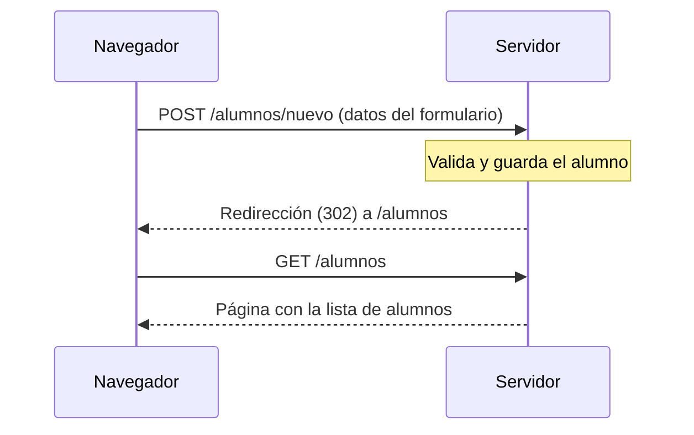

# 4. Post/Redirect/Get y mensajes flash

En la página anterior, cuando los datos eran válidos, el controlador terminaba con
`return "redirect:/alumnos"`. No era un capricho: es una técnica estándar en cualquier aplicación
web que reciba formularios. En esta página vemos qué problema resuelve, y cómo mostrar al usuario un
mensaje de confirmación ("Alumno guardado correctamente") a pesar de la redirección.

## 4.1. El problema: recargar la página tras un `POST`

Supongamos que el controlador que recibe el formulario de alta guarda el alumno y, en lugar de
redirigir, **muestra directamente** la lista de alumnos:

```java
@PostMapping("/nuevo")
public String guardar(@ModelAttribute Alumno alumno, Model model) {
    servicio.guardar(alumno);
    model.addAttribute("alumnos", servicio.listarTodos());
    return "alumnos"; // se devuelve la vista directamente
}
```

Funciona, pero tiene un fallo de fondo. La página que ve el usuario es el resultado de una petición
`POST` a `/alumnos/nuevo`. Si pulsa **F5** (o recarga de cualquier otra forma), el navegador no
sabe qué hacer y pregunta:

> ¿Quieres volver a enviar el formulario?

Si el usuario acepta, se repite el `POST` con los mismos datos y **se guarda otro alumno igual**.
Es la consecuencia de lo que vimos en la página de GET y POST: `POST` no es idempotente, y repetirlo
repite sus efectos. Ocurre lo mismo con el botón de retroceso, o si el usuario vuelve a la página
desde el historial.

Además, la URL que queda en el navegador es `/alumnos/nuevo`, aunque la pantalla muestre la lista
de alumnos.

## 4.2. El patrón Post/Redirect/Get

La solución consiste en **no devolver una página como respuesta a un `POST`**. En su lugar, el
servidor responde con una **redirección** hacia otra ruta, y es esa segunda petición, un `GET`, la
que muestra la página:



De ahí el nombre del patrón: **P**ost, **R**edirect, **G**et. Se consigue con el prefijo
`redirect:` que ya vimos en la Unidad 2:

```java
@PostMapping("/nuevo")
public String guardar(@Valid @ModelAttribute("alumno") Alumno alumno,
                      BindingResult resultado) {

    if (resultado.hasErrors()) {
        return "alumno-form";
    }

    servicio.guardar(alumno);
    return "redirect:/alumnos"; // Post -> Redirect -> Get
}
```

Ahora, la página que ve el usuario es el resultado de un `GET /alumnos`, y:

- Recargar la página repite un `GET`, que es inocuo: no se guarda nada de nuevo.
- La URL del navegador es la de la página que realmente se está viendo.
- El navegador no vuelve a mostrar el aviso de reenvío del formulario.

:::note
Cuándo se aplica y cuándo no
La redirección se hace cuando el `POST` **ha tenido éxito** y ha modificado algo. Si hay errores de
validación, se devuelve la vista del formulario directamente (`return "alumno-form"`), sin
redirigir: así los errores y lo que el usuario escribió llegan a la plantilla. No pasa nada por
recargar en ese caso, porque no se había guardado nada.
:::

Como regla general, **todo `POST` que modifica datos debe terminar en una redirección**: altas,
ediciones y borrados.

## 4.3. El nuevo problema: el mensaje se pierde

Con la redirección aparece una dificultad. Un `redirect:` produce una **petición nueva**, y los
datos del modelo de la petición anterior no viajan con ella. Si en el método del `POST`
hacemos `model.addAttribute("mensaje", "Alumno guardado")` y después redirigimos, la lista de
alumnos no tendrá ningún `mensaje` que mostrar.

Una solución ingenua es pasarlo en la URL:

```java
return "redirect:/alumnos?guardado=true";
```

y recogerlo en el `GET` con `@RequestParam(required = false) boolean guardado`. Funciona, pero tiene
varios inconvenientes:

- La URL queda "ensuciada" con el parámetro.
- Si el usuario recarga la página, o la guarda como marcador, el mensaje **vuelve a aparecer**.
- Cualquiera puede escribir la URL a mano y provocar el mensaje sin haber guardado nada.

Lo que necesitamos es un mensaje que **sobreviva a una redirección y se muestre una sola vez**. Eso
son los **atributos *flash***.

## 4.4. Atributos *flash*: `RedirectAttributes`

Spring ofrece la interfaz `RedirectAttributes`, que se recibe como parámetro del método, igual que
`Model`. Su método `addFlashAttribute` guarda un dato **temporalmente** (en la sesión del usuario)
con una condición: estará disponible en la **siguiente petición**, y después se elimina.

```java
@PostMapping("/nuevo")
public String guardar(@Valid @ModelAttribute("alumno") Alumno alumno,
                      BindingResult resultado,
                      RedirectAttributes redirect) {

    if (resultado.hasErrors()) {
        return "alumno-form";
    }

    servicio.guardar(alumno);
    redirect.addFlashAttribute("mensaje", "Alumno guardado correctamente");
    return "redirect:/alumnos";
}
```

:::note
El orden de los parámetros
`BindingResult` debe seguir siendo el parámetro **inmediatamente posterior** al objeto validado.
`RedirectAttributes` se coloca después.
:::

El método que atiende la redirección (`GET /alumnos`) **no necesita ningún código extra**: Spring
incorpora automáticamente los atributos *flash* al modelo de esa petición, y la plantilla los lee
como cualquier otro dato.

```java
@GetMapping
public String listar(Model model) {
    model.addAttribute("alumnos", servicio.listarTodos());
    return "alumnos";
}
```

```html title="templates/alumnos.html"
<p class="alerta alerta-exito" th:if="${mensaje}" th:text="${mensaje}">Mensaje</p>
```

`th:if="${mensaje}"` hace que el párrafo solo aparezca cuando existe un mensaje (recuerda que
`null` se considera falso). Si el usuario abre la lista por su cuenta, sin haber guardado nada, no
hay atributo *flash* y el párrafo no se muestra.

### Solo se muestra una vez

Un atributo *flash* dura exactamente una petición. Si tras ver el mensaje el usuario recarga la
lista, el navegador hace otro `GET /alumnos`, y esta vez el atributo ya no existe: el mensaje
desaparece. Es justo el comportamiento que buscábamos, y lo que lo diferencia de pasar el dato por
la URL.

### `addAttribute` frente a `addFlashAttribute`

`RedirectAttributes` tiene también un método `addAttribute`, y conviene no confundirlos:

| | `addAttribute` | `addFlashAttribute` |
|---|---|---|
| Dónde viaja el dato | En la URL de la redirección, como *query string* | Guardado en la sesión, invisible |
| ¿Visible para el usuario? | Sí | No |
| Duración | Está en la URL mientras esa URL exista | Solo la siguiente petición |
| Tipo de dato | Valores simples (texto, números) | Cualquier objeto |
| Uso típico | Pasar un identificador o un filtro a la página de destino | Mensajes de confirmación o de error |

## 4.5. Varios mensajes y distintos tipos

Se pueden añadir tantos atributos *flash* como se necesiten. Una combinación habitual es un texto y
un tipo, para poder mostrar los mensajes de éxito y de error con distinto estilo:

```java
redirect.addFlashAttribute("mensaje", "Alumno guardado correctamente");
redirect.addFlashAttribute("tipo", "exito");
```

Si en la Unidad 2 creaste el fragmento `alerta(mensaje, tipo)`, se puede reutilizar aquí:

```html
<th:block th:if="${mensaje}">
    <div th:replace="~{fragmentos/comunes :: alerta(${mensaje}, ${tipo})}"></div>
</th:block>
```

:::note
¿Por qué un `th:block` alrededor?
Podría parecer más corto escribir `th:if` y `th:replace` en el mismo `<div>`, pero Thymeleaf
procesa los atributos en un orden fijo, y `th:replace` se evalúa **antes** que `th:if`: el
fragmento se insertaría siempre, aunque no hubiera mensaje. Con `th:block` la condición queda en
una etiqueta propia, que se evalúa antes de llegar al `th:replace`.
:::

## 4.6. Ejemplo completo

Servicio en memoria, solo para poder probar el ejemplo (los datos se pierden al reiniciar la
aplicación):

```java
@Service
public class ServicioAlumnos {

    private final List<Alumno> alumnos = new ArrayList<>();

    public List<Alumno> listarTodos() {
        return alumnos;
    }

    public void guardar(Alumno alumno) {
        alumnos.add(alumno);
    }
}
```

Controlador:

```java
@Controller
@RequestMapping("/alumnos")
public class AlumnosController {

    private final ServicioAlumnos servicio;

    @Autowired
    public AlumnosController(ServicioAlumnos servicio) {
        this.servicio = servicio;
    }

    @GetMapping
    public String listar(Model model) {
        model.addAttribute("alumnos", servicio.listarTodos());
        return "alumnos";
    }

    @GetMapping("/nuevo")
    public String formulario(Model model) {
        model.addAttribute("alumno", new Alumno());
        return "alumno-form";
    }

    @PostMapping("/nuevo")
    public String guardar(@Valid @ModelAttribute("alumno") Alumno alumno,
                          BindingResult resultado,
                          RedirectAttributes redirect) {

        if (resultado.hasErrors()) {
            return "alumno-form";
        }

        servicio.guardar(alumno);
        redirect.addFlashAttribute("mensaje", "Alumno guardado correctamente");
        return "redirect:/alumnos";
    }
}
```

Para comprobar la diferencia entre las dos versiones, prueba esto en el navegador:

1. Con la versión del apartado 4.1 (sin redirección), guarda un alumno y pulsa **F5**. El navegador
   pregunta si quieres reenviar el formulario, y si aceptas aparece el alumno duplicado.
2. Con la versión de este apartado, guarda un alumno: aparece la lista con el mensaje. Pulsa
   **F5**: no hay aviso de reenvío, no se duplica nada y el mensaje desaparece.
3. Abre la pestaña **Red** de las herramientas del navegador y repite el alta: verás la petición
   `POST` con respuesta 302 y, justo después, el `GET /alumnos`.

## 4.7. Resumen

| Concepto | Qué hace |
|---|---|
| Post/Redirect/Get | Un `POST` que modifica datos responde con una redirección, y es un `GET` el que muestra la página |
| `redirect:/ruta` | Devuelve la redirección desde el controlador |
| Qué se evita | El reenvío del formulario al recargar y los datos duplicados |
| `RedirectAttributes` | Parámetro que permite pasar datos a través de una redirección |
| `addFlashAttribute` | Guarda un dato para la siguiente petición, una sola vez, sin mostrarlo en la URL |
| `addAttribute` | Añade el dato a la URL como parámetro (visible y repetible) |
