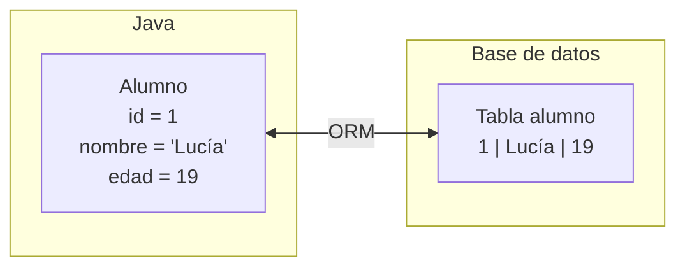
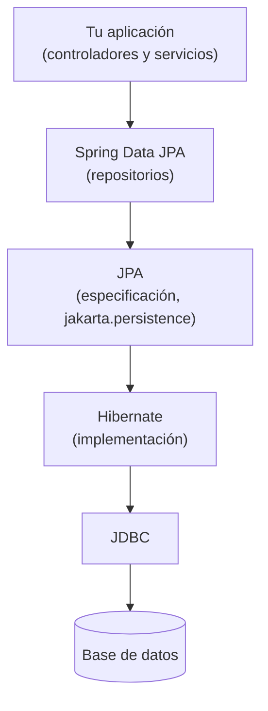

# 1. Introducción a la persistencia con JPA

Hasta ahora, los datos de nuestras aplicaciones vivían en una lista dentro del repositorio. Funciona para
probar, pero tiene un fallo evidente: cuando la aplicación se reinicia, **todo se pierde**. Una
aplicación real necesita **persistencia**: guardar los datos en un sitio donde sobrevivan, normalmente
una base de datos relacional. En esta unidad aprendemos a hacerlo con Spring Data JPA.

:::note
Conocimientos previos
Esta unidad asume nociones básicas de bases de datos relacionales, vistas en otros módulos: tablas,
claves primarias y foráneas, y las sentencias `SELECT`, `INSERT`, `UPDATE` y `DELETE`.
:::

## 1.1. La forma clásica: JDBC

Java incluye desde hace tiempo una API para hablar con bases de datos: **JDBC**. Con ella, el
programador escribe las sentencias SQL a mano y recorre los resultados. Así se obtendría la lista de
alumnos (suponiendo que `Alumno` ya tiene un `id`, algo que añadiremos al convertirla en entidad):

```java
public List<Alumno> listarTodos() throws SQLException {
    List<Alumno> alumnos = new ArrayList<>();
    String sql = "SELECT id, nombre, curso, edad FROM alumno";

    try (Connection conexion = DriverManager.getConnection(url, usuario, clave);
         PreparedStatement sentencia = conexion.prepareStatement(sql);
         ResultSet resultado = sentencia.executeQuery()) {

        while (resultado.next()) {
            Alumno alumno = new Alumno();
            alumno.setId(resultado.getLong("id"));
            alumno.setNombre(resultado.getString("nombre"));
            alumno.setCurso(resultado.getString("curso"));
            alumno.setEdad(resultado.getInt("edad"));
            alumnos.add(alumno);
        }
    }
    return alumnos;
}
```

Y este es solo el método de **consultar**. Insertar, actualizar y borrar requieren su propio
`PreparedStatement`, con sus parámetros asignados uno a uno. El código funciona, pero tiene
inconvenientes que se multiplican con cada clase de la aplicación:

- **Mucho código repetitivo**: abrir la conexión, preparar la sentencia, recorrer el resultado,
  cerrar los recursos.
- **Conversión manual**: hay que copiar cada columna a su atributo, y cada atributo a su parámetro,
  sin que el compilador revise los nombres de las columnas.
- **SQL mezclado con Java**: las sentencias son simples textos, y un error en uno de ellos solo se
  descubre al ejecutar.
- **Dependencia del SQL de cada base de datos**: algunas sentencias cambian entre MySQL, PostgreSQL u
  Oracle.

## 1.2. El desajuste entre objetos y tablas

El problema de fondo es que **los objetos y las tablas no se parecen tanto como parece**. Java organiza
la información en clases y referencias; una base de datos relacional, en tablas y claves foráneas. A
esta diferencia se le llama *desajuste objeto-relacional*.

| Mundo Java (objetos) | Mundo relacional (tablas) |
|---|---|
| Clase `Alumno` | Tabla `alumno` |
| Atributo `nombre` | Columna `nombre` |
| Objeto (una instancia) | Fila |
| Referencia a otro objeto (`alumno.getCurso()`) | Clave foránea (`curso_id`) |
| Colección de objetos (`curso.getAlumnos()`) | No hay columna: se obtiene con una consulta |
| Identidad: la referencia (`==`) o `equals` | Identidad: la clave primaria |
| Herencia entre clases | No existe |
| Tipos Java (`LocalDate`, `enum`...) | Tipos SQL (`DATE`, `VARCHAR`...) |

Con JDBC, traducir entre un mundo y otro es responsabilidad del programador, en cada consulta.

## 1.3. ORM: que lo haga una herramienta

Un **ORM** (*Object-Relational Mapping*, mapeo objeto-relacional) es una herramienta que se encarga
de esa traducción. El programador **describe** cómo se corresponde cada clase con su tabla, y el ORM
se ocupa de generar el SQL necesario y de convertir las filas en objetos y los objetos en filas.



Con un ORM, guardar un alumno se reduce a pasarle el objeto, sin escribir el `INSERT`; y obtenerlo es
pedirle el objeto, sin recorrer ningún `ResultSet`.

Las ventajas son claras: menos código, menos errores, y una aplicación más independiente de la base
de datos concreta. También tiene un precio:

- Hay que aprender cómo funciona, y al principio parece que "ocurren cosas solas".
- El SQL que genera automáticamente no siempre es el más eficiente, y conviene saber leerlo.
- Para consultas muy específicas puede hacer falta escribir SQL a mano; el ORM no lo impide, como
  veremos más adelante.

## 1.4. JPA, Hibernate y Spring Data JPA

Al buscar información sobre este tema aparecen tres nombres que se confunden con mucha facilidad.
Son tres cosas distintas, que trabajan en capas:

| Nombre | Qué es | Su papel |
|---|---|---|
| **JPA** (*Jakarta Persistence*) | Una **especificación**: un conjunto de interfaces y anotaciones | Define **cómo** se mapean clases a tablas y cómo se consulta. No contiene la lógica: es un contrato |
| **Hibernate** | Una **implementación** de JPA | Es quien realmente genera el SQL y gestiona las conexiones. Es el que usa Spring Boot por defecto |
| **Spring Data JPA** | Un módulo de Spring que trabaja **sobre** JPA | Genera automáticamente los repositorios, para que no haya que escribir ni siquiera el código de acceso básico |



Una analogía: JPA es como una **interfaz** de Java, Hibernate es una **clase que la implementa** y
Spring Data JPA es una capa que se encarga de **escribir por nosotros el código repetitivo** que usa
esa implementación.

Por debajo de todo sigue estando JDBC: Hibernate lo usa para hablar con la base de datos. Dejamos de
escribirlo nosotros, pero no desaparece.

:::note
¿Por qué `jakarta.persistence`?
JPA se llamó durante años *Java Persistence API*, y sus clases estaban en el paquete
`javax.persistence`. Al pasar la plataforma a la Fundación Eclipse, el nombre cambió a *Jakarta
Persistence* y el paquete a `jakarta.persistence`. Es el mismo cambio que vimos con
`jakarta.validation`: en Spring Boot 3 se usa siempre `jakarta`, y si copias código antiguo de
internet con `javax`, no compilará.
:::

JPA tiene un objeto central, el `EntityManager`, con el que se pueden hacer todas las operaciones.
En esta unidad **no lo usaremos directamente**: Spring Data JPA nos lo oculta tras los repositorios,
que es mucho más cómodo.

## 1.5. Dónde encaja en nuestra aplicación

En la Unidad 2 organizamos la aplicación en capas: **Controller → Service → Repository**. Hasta ahora,
la capa de repositorio era (en el mejor de los casos) una lista en memoria. Con Spring Data JPA, esa
capa pasa a ser una **interfaz** que Spring convierte en un repositorio real conectado a la base de
datos, y el resto de capas casi no cambia.

Como adelanto de lo que veremos en las siguientes páginas, así se transforma el servicio de la
Unidad 3.

**Antes**, con una lista en memoria:

```java
@Service
public class ServicioAlumnos {

    private final List<Alumno> alumnos = new ArrayList<>();

    public List<Alumno> listarTodos() {
        return alumnos;
    }

    public void guardar(Alumno alumno) {
        alumnos.add(alumno);
    }
}
```

**Después**, con Spring Data JPA:

```java
public interface AlumnoRepository extends JpaRepository<Alumno, Long> { }
```

```java
@Service
public class ServicioAlumnos {

    private final AlumnoRepository repositorio;

    public ServicioAlumnos(AlumnoRepository repositorio) {
        this.repositorio = repositorio;
    }

    public List<Alumno> listarTodos() {
        return repositorio.findAll();
    }

    public void guardar(Alumno alumno) {
        repositorio.save(alumno);
    }
}
```

El repositorio se inyecta en el servicio igual que cualquier otra dependencia (Unidad 2), y el
controlador **no cambia en absoluto**: sigue llamando a `listarTodos()` y `guardar(...)` sin saber que
ahora los datos viven en una base de datos.

:::note
Una interfaz sin implementación
Fíjate en que `AlumnoRepository` es una interfaz vacía y que **no hay ninguna clase que la
implemente**. Es Spring Data JPA quien, al arrancar, genera la implementación y la registra como
*bean*. Los métodos `findAll` y `save` los hereda de `JpaRepository`.
:::

## 1.6. Qué veremos en la unidad

| Tema | Qué aprenderemos |
|---|---|
| Puesta en marcha | Dependencias, base de datos H2 y configuración |
| Entidades | Convertir una clase Java en una tabla |
| Repositorios | Las operaciones básicas de consulta, alta, edición y borrado |
| Consultas | Derivadas del nombre del método y con JPQL |
| Ordenación y paginación | Listados ordenados y por páginas |
| Relaciones | Entre entidades: uno a muchos, muchos a muchos y uno a uno |
| Servicios y transacciones | Cómo agrupar operaciones de forma segura |

## 1.7. Resumen

| Concepto | Idea clave |
|---|---|
| Persistencia | Guardar los datos de forma que sobrevivan al reinicio de la aplicación |
| JDBC | API de Java para hablar con bases de datos escribiendo SQL a mano |
| Desajuste objeto-relacional | Las clases y las tablas se organizan de forma distinta |
| ORM | Herramienta que traduce entre objetos y filas |
| JPA | Especificación (el contrato) de cómo se hace ese mapeo |
| Hibernate | Implementación de JPA, usada por Spring Boot por defecto |
| Spring Data JPA | Capa que genera los repositorios sobre JPA |
