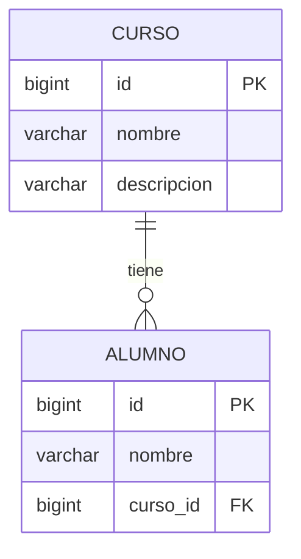

# 8. Relaciones entre entidades (I): `@ManyToOne` y `@OneToMany`

Hasta ahora, el curso de un alumno era un simple texto (`"1DAW"`). Pero un curso es algo más que un
nombre: tiene una descripción, varios alumnos, y en el futuro tendrá más datos. En una base de datos
relacional eso se resuelve con **dos tablas relacionadas por una clave foránea**. En esta página
vemos cómo expresar esa relación en JPA.

## 8.1. El modelo: un curso, muchos alumnos



Es una relación **uno a muchos**: un curso tiene muchos alumnos, y cada alumno pertenece a un único
curso. Visto desde el otro lado, es **muchos a uno**: muchos alumnos tienen el mismo curso.

En JPA, los dos lados de esa relación tienen su anotación:

| Desde la clase | Anotación | Se lee como |
|---|---|---|
| `Alumno` | `@ManyToOne` | Muchos alumnos pertenecen a un curso |
| `Curso` | `@OneToMany` | Un curso tiene muchos alumnos |

En la base de datos, sin embargo, solo hay **una clave foránea**: la columna `curso_id` de la tabla
`alumnos`.

## 8.2. `@ManyToOne` y `@JoinColumn`

La entidad `Curso` es una entidad como las que ya conocemos:

```java
@Entity
@Table(name = "cursos")
public class Curso {

    @Id
    @GeneratedValue(strategy = GenerationType.IDENTITY)
    private Long id;

    @Column(nullable = false, unique = true, length = 10)
    private String nombre;          // "1DAW"

    @Column(length = 100)
    private String descripcion;     // "Primero de Desarrollo de Aplicaciones Web"

    public Curso() { }

    // getters y setters
}
```

Y en `Alumno`, el atributo `curso` pasa de ser un `String` a ser un `Curso`, anotado con
`@ManyToOne`:

```java
@NotNull(message = "Debes elegir un curso")
@ManyToOne
@JoinColumn(name = "curso_id", nullable = false)
private Curso curso;
```

- **`@ManyToOne`** indica que es el lado "muchos" de la relación.
- **`@JoinColumn`** indica cómo se llama la columna de la clave foránea en **esta** tabla
  (`curso_id`), y con `nullable = false` se exige que todo alumno tenga curso.
- La anotación de validación cambia de `@NotBlank` a `@NotNull`, porque ya no es un texto.

Con `ddl-auto=update`, Hibernate genera algo parecido a:

```sql
create table cursos (
    id bigint not null auto_increment,
    nombre varchar(10) not null,
    descripcion varchar(100),
    primary key (id)
)

create table alumnos (
    id bigint not null auto_increment,
    -- ...resto de columnas...
    curso_id bigint not null,
    primary key (id)
)

alter table alumnos add constraint FK... foreign key (curso_id) references cursos (id)
```

### Usarlo

Se trabaja con **objetos**, no con identificadores: para asignar un curso a un alumno se le asigna el
objeto `Curso`, y Hibernate se encarga de rellenar `curso_id`.

```java
Curso daw1 = cursoRepositorio.save(crearCurso("1DAW", "Primero de Desarrollo de Aplicaciones Web"));

Alumno eva = new Alumno();
eva.setNombre("Eva Soto");
eva.setCurso(daw1);                 // se asigna el objeto, no un texto ni un id
// ... resto de campos
alumnoRepositorio.save(eva);        // inserta el alumno con curso_id = id de daw1
```

Y se lee navegando por los objetos: `alumno.getCurso().getNombre()`.

:::note
El curso debe estar guardado antes
Si se asigna a un alumno un `Curso` que **todavía no se ha guardado** (su `id` es `null`), el guardado
falla con un error del estilo `object references an unsaved transient instance`. Hay que guardar
primero el curso, o configurar `cascade` (lo veremos más abajo).
:::

## 8.3. `@OneToMany` y `mappedBy`: la relación bidireccional

Con lo anterior ya se puede ir de un alumno a su curso. Pero si se quiere ir al revés (dado un
curso, obtener sus alumnos con `curso.getAlumnos()`), hace falta declarar también el otro lado,
con `@OneToMany`:

```java
@OneToMany(mappedBy = "curso")
private List<Alumno> alumnos = new ArrayList<>();
```

El atributo clave es **`mappedBy = "curso"`**. Le dice a JPA: "esta relación ya está definida en la
clase `Alumno`, en su atributo llamado `curso`; no crees nada más". Es el **nombre del atributo** de
`Alumno`, no el de la columna.

### El lado propietario

En toda relación bidireccional hay un **lado propietario**, el que controla la clave foránea, y un
**lado inverso**, que solo es un "espejo" de lectura:

| | Lado propietario | Lado inverso |
|---|---|---|
| Clase | `Alumno` | `Curso` |
| Anotación | `@ManyToOne` + `@JoinColumn` | `@OneToMany(mappedBy = ...)` |
| Qué hace | Es el que escribe `curso_id` en la base de datos | Solo se lee; no guarda nada por sí mismo |
| Regla general | El lado "muchos" (el que tiene la clave foránea) | El lado "uno", con `mappedBy` |

La consecuencia práctica es muy importante: **solo cuenta lo que se asigna en el lado propietario**.

```java
curso.getAlumnos().add(eva);        // NO basta: no se guarda ninguna relación
eva.setCurso(curso);                // esto es lo que escribe curso_id
```

Añadir el alumno a la lista del curso, sin hacer `eva.setCurso(curso)`, no guarda nada. Y al revés,
asignar `setCurso` no actualiza la lista del curso que ya estuviera cargada en memoria. Para que
ambos lados estén siempre de acuerdo, se acostumbra a escribir un método auxiliar en `Curso`:

```java
public void agregarAlumno(Alumno alumno) {
    alumnos.add(alumno);
    alumno.setCurso(this);
}

public void quitarAlumno(Alumno alumno) {
    alumnos.remove(alumno);
    alumno.setCurso(null);
}
```

### ¿Unidireccional o bidireccional?

| | Solo `@ManyToOne` (unidireccional) | `@ManyToOne` + `@OneToMany` (bidireccional) |
|---|---|---|
| Se puede ir de alumno a curso | Sí | Sí |
| Se puede ir de curso a alumnos | No (hay que consultar con el repositorio) | Sí, con `curso.getAlumnos()` |
| Complejidad | Menor | Mayor: hay que mantener los dos lados |

Si no hace falta recorrer la relación desde el curso, **la unidireccional es suficiente** y más
sencilla. Se añade el lado `@OneToMany` solo cuando se necesita.

:::note
`@OneToMany` sin `mappedBy`
Si se escribe `@OneToMany` **sin** `mappedBy`, JPA entiende que es una relación unidireccional distinta
de la que ya existe con `@ManyToOne`, y crea una **tabla intermedia** adicional (`cursos_alumnos`)
para guardarla. Es un error muy habitual: si aparece una tabla que no esperabas, falta el `mappedBy`.
:::

## 8.4. Repositorios y datos

Cada entidad tiene su repositorio:

```java
public interface CursoRepository extends JpaRepository<Curso, Long> {

    Optional<Curso> findByNombre(String nombre);

    List<Curso> findAllByOrderByNombreAsc();
}
```

### Qué cambia respecto a lo anterior

Cambiar `curso` de texto a entidad afecta a lo escrito en las páginas anteriores:

| Dónde | Antes | Ahora |
|---|---|---|
| La entidad `Alumno` | `private String curso;` | `@ManyToOne` `private Curso curso;` |
| Consulta derivada | `findByCurso(String curso)` | `findByCursoNombre(String nombre)` |
| JPQL | `a.curso = :curso` | `a.curso.nombre = :curso` |
| Consulta de resumen (`select new`) | `new ...ResumenCurso(a.curso, count(a))` | `new ...ResumenCurso(a.curso.nombre, count(a))`, con `group by a.curso.nombre` |
| Plantillas | `${alumno.curso}` | `${alumno.curso.nombre}` |
| Componente de pruebas | `alumno.setCurso("2DAW")` | `alumno.setCurso(curso)`, con un `Curso` guardado antes |

Si en una plantilla se deja `${alumno.curso}`, no se produce un error: se imprime el `toString()` del
objeto (algo como `es.centro...Curso@3f2a1b`).

### Los datos de `import.sql`

Ahora hay que crear primero los cursos, y los alumnos hacen referencia a ellos. Una forma de evitar
depender de los números de identificador es buscarlos con una subconsulta:

```sql title="src/main/resources/import.sql"
INSERT INTO cursos (nombre, descripcion) VALUES ('1DAW', 'Primero de Desarrollo de Aplicaciones Web');
INSERT INTO cursos (nombre, descripcion) VALUES ('2DAW', 'Segundo de Desarrollo de Aplicaciones Web');
INSERT INTO cursos (nombre, descripcion) VALUES ('1DAM', 'Primero de Desarrollo de Aplicaciones Multiplataforma');

INSERT INTO alumnos (nombre, curso_id, edad, email, fecha_nacimiento, turno) VALUES ('Eva Soto', (SELECT id FROM cursos WHERE nombre = '1DAW'), 18, 'eva@centro.es', '2007-05-21', 'MANANA');
INSERT INTO alumnos (nombre, curso_id, edad, email, fecha_nacimiento, turno) VALUES ('Carlos Ruiz', (SELECT id FROM cursos WHERE nombre = '2DAW'), 20, 'carlos@centro.es', '2005-11-02', 'TARDE');
INSERT INTO alumnos (nombre, curso_id, edad, email, fecha_nacimiento, turno) VALUES ('Marta Gil', (SELECT id FROM cursos WHERE nombre = '1DAM'), 19, 'marta@centro.es', '2006-08-14', 'MANANA');
```

:::note
Cambiar el esquema con datos ya creados
Si la tabla `alumnos` ya existía con la columna `curso` de texto, `ddl-auto=update` **no la
convierte**: añade la nueva columna `curso_id`, pero deja la antigua, y las filas que ya existían no
tienen un curso válido al que apuntar (la restricción de clave foránea puede incluso fallar al crearse). Durante el desarrollo, lo más sencillo es volver a crear las tablas con el perfil
`datos` (`ddl-auto=create`) o borrar el volumen de Docker con `docker compose down -v`.
:::

## 8.5. Consultas que atraviesan la relación

### Consultas derivadas

En una consulta derivada, se puede **navegar** por la relación escribiendo seguidos los nombres de los
atributos:

```java
// Alumnos cuyo curso tiene este nombre: a.curso.nombre
List<Alumno> findByCursoNombre(String nombre);

// Alumnos de un curso concreto, dado por su objeto o por su id
List<Alumno> findByCurso(Curso curso);
List<Alumno> findByCursoId(Long cursoId);

long countByCursoId(Long cursoId);
```

`findByCursoNombre` se interpreta como "el atributo `nombre` del atributo `curso`". Si hubiera
ambigüedad (por ejemplo, si `Alumno` tuviera también un atributo llamado `cursoNombre`), se puede
indicar la separación con un guion bajo: `findByCurso_Nombre`.

### JPQL

En JPQL se navega con el punto, y se puede enlazar explícitamente con `join`:

```java
@Query("select a from Alumno a where a.curso.nombre = :nombre order by a.nombre")
List<Alumno> buscarPorNombreDeCurso(@Param("nombre") String nombre);

@Query("""
        select a from Alumno a
        join a.curso c
        where c.nombre = :nombre and a.edad >= :edad
        """)
List<Alumno> buscarMayoresDeUnCurso(@Param("nombre") String nombre, @Param("edad") int edad);
```

Un `join` en JPQL se escribe sobre **el atributo de la relación** (`join a.curso c`), no sobre
columnas con `on`. Hibernate deduce el resto a partir del mapeo.

## 8.6. `cascade` y `orphanRemoval`

Por defecto, cada entidad se guarda y se borra **por separado**. Con `cascade`, una operación sobre la
entidad padre se **propaga** a las entidades relacionadas:

| Tipo | Qué propaga |
|---|---|
| `PERSIST` | Al guardar la entidad nueva, se guardan también las nuevas relacionadas |
| `MERGE` | Al actualizar la entidad, se actualizan también las relacionadas |
| `REMOVE` | Al borrar la entidad, se borran también las relacionadas |
| `ALL` | Todas las anteriores |

Y **`orphanRemoval = true`** hace que, si se quita un elemento de la colección, ese elemento se
borre de la base de datos (queda "huérfano" y se elimina).

Tiene sentido cuando los hijos **no existen por sí solos**: no hay una línea de pedido sin su pedido.

```java
@Entity
public class Pedido {

    @Id
    @GeneratedValue(strategy = GenerationType.IDENTITY)
    private Long id;

    @OneToMany(mappedBy = "pedido", cascade = CascadeType.ALL, orphanRemoval = true)
    private List<LineaPedido> lineas = new ArrayList<>();
}
```

Al guardar el `Pedido`, se guardan sus líneas; al borrarlo, se borran; y al quitar una línea de la
lista, se elimina de la base de datos.

**En nuestro caso, no lo activamos.** Un alumno sí existe por sí solo y borrar un curso **no debe
borrar a sus alumnos** de forma silenciosa. Sin `cascade`, intentar borrar un curso que todavía
tiene alumnos falla con un error de clave foránea, que es justo lo que queremos: antes de borrar el
curso hay que decidir qué se hace con sus alumnos.

:::note
Cuidado con `REMOVE` y `ALL`
Es la parte de `cascade` que más datos puede borrar sin avisar. Úsala solo cuando los hijos
dependan por completo del padre.
:::

## 8.7. Mostrar la relación en las plantillas

### El curso de cada alumno

Basta con navegar por los objetos en la expresión:

```html
<tr th:each="alumno : ${pagina.content}">
    <td th:text="${alumno.nombre}">Nombre</td>
    <td>
        <a th:href="@{/cursos/{id}(id=${alumno.curso.id})}" th:text="${alumno.curso.nombre}">1DAW</a>
    </td>
    <td th:text="${alumno.edad}">Edad</td>
</tr>
```

Si el curso pudiera ser `null`, se usa la navegación segura de la Unidad 2: `${alumno.curso?.nombre}`.

### Un curso y sus alumnos

```java
@Controller
@RequestMapping("/cursos")
public class CursosController {

    private final CursoRepository repositorio;

    public CursosController(CursoRepository repositorio) {
        this.repositorio = repositorio;
    }

    @GetMapping
    public String listar(Model model) {
        model.addAttribute("cursos", repositorio.findAllByOrderByNombreAsc());
        return "cursos";
    }

    @GetMapping("/{id}")
    public String detalle(@PathVariable Long id, Model model) {
        Curso curso = repositorio.findById(id)
                .orElseThrow(() -> new ResponseStatusException(HttpStatus.NOT_FOUND));
        model.addAttribute("curso", curso);
        return "curso-detalle";
    }
}
```

```html title="templates/cursos.html"
<table>
    <tr th:each="curso : ${cursos}">
        <td>
            <a th:href="@{/cursos/{id}(id=${curso.id})}" th:text="${curso.nombre}">1DAW</a>
        </td>
        <td th:text="${curso.descripcion}">Descripción</td>
        <td th:text="${#lists.size(curso.alumnos)}">0</td>
    </tr>
</table>
```

```html title="templates/curso-detalle.html"
<h1 th:text="${curso.nombre}">1DAW</h1>
<p th:text="${curso.descripcion}">Descripción</p>

<ul>
    <li th:each="alumno : ${curso.alumnos}" th:text="${alumno.nombre}">Alumno</li>
</ul>
<p th:if="${#lists.isEmpty(curso.alumnos)}">Este curso no tiene alumnos.</p>
```

:::note
La lista de alumnos se carga al usarla
La colección `curso.alumnos` **no se carga junto con el curso**: Hibernate la recupera con una consulta
adicional en el momento en que la plantilla la recorre (carga *perezosa* o *lazy*). Funciona porque
Spring Boot mantiene la conexión abierta mientras se genera la vista. En el listado de cursos, esto
significa una consulta extra **por cada curso**. La siguiente página explica este comportamiento y
sus límites.
:::

:::note
Los formularios con relaciones
Un formulario que permita elegir el curso de un alumno (un `<select>` con los cursos disponibles)
plantea problemas propios, como convertir el identificador recibido en un objeto `Curso`. Los
resolveremos en el ejemplo integrador.
:::

## 8.8. Errores habituales

| Síntoma | Causa probable | Solución |
|---|---|---|
| `object references an unsaved transient instance` | Se ha asignado un `Curso` sin guardar (su `id` es `null`) | Guarda el curso antes, o usa `cascade` donde tenga sentido |
| `not-null property references a null or transient value` | Se intenta guardar un alumno sin curso | Asigna el curso antes de guardar |
| `Cannot add or update a child row: a foreign key constraint fails` | El `curso_id` no corresponde a ningún curso | Comprueba que el curso existe |
| `Cannot delete or update a parent row: a foreign key constraint fails` (`DataIntegrityViolationException`) | Se intenta borrar un curso que todavía tiene alumnos | Comprueba antes si tiene alumnos (por ejemplo, con `countByCursoId`) y decide qué hacer |
| Aparece una tabla inesperada (`cursos_alumnos`) | Falta `mappedBy` en el `@OneToMany` | Añade `mappedBy = "curso"` |
| `curso.getAlumnos()` no incluye al alumno recién guardado | Solo se asignó un lado de la relación | Asigna `setCurso` y usa un método auxiliar que mantenga las dos listas |
| `Field 'curso' doesn't have a default value` | La tabla conserva la columna `curso` antigua | Vuelve a crear las tablas (perfil `datos`) |

## 8.9. Resumen

| Concepto | Idea clave |
|---|---|
| Relación uno a muchos | Un curso tiene muchos alumnos; en la base de datos, una clave foránea en la tabla de los "muchos" |
| `@ManyToOne` + `@JoinColumn` | Lado propietario: el que tiene la columna de la clave foránea |
| `@OneToMany(mappedBy = "...")` | Lado inverso: solo permite navegar desde el "uno" |
| Unidireccional / bidireccional | Basta con `@ManyToOne` si no hace falta ir del curso a sus alumnos |
| Mantener los dos lados | Lo que cuenta es el lado propietario; un método auxiliar mantiene la lista sincronizada |
| `cascade` y `orphanRemoval` | Propagan operaciones a los hijos; solo si dependen por completo del padre |
| Consultas | `findByCursoNombre`, `a.curso.nombre` y `join a.curso c` |
| Plantillas | `${alumno.curso.nombre}` y `th:each` sobre `curso.alumnos` |
