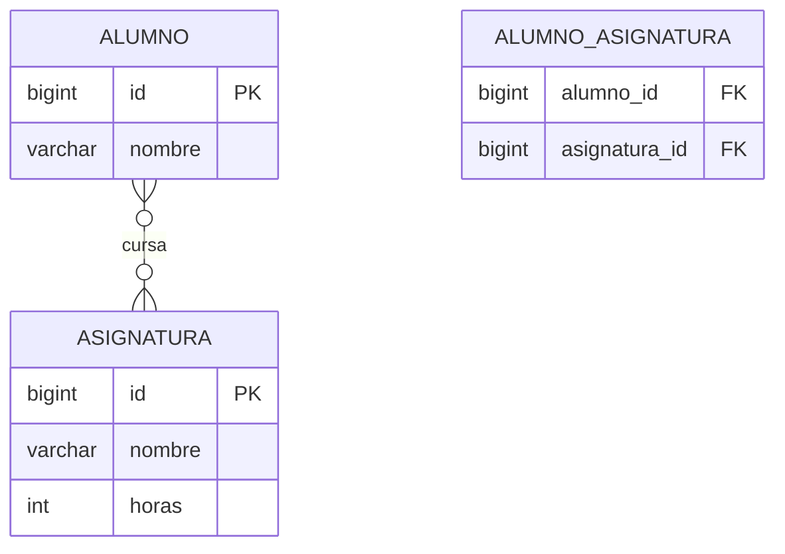

# 9. Relaciones entre entidades (II): `@ManyToMany`, `@OneToOne` y tipo de carga

En la página anterior vimos la relación más habitual, la de uno a muchos. Quedan otras dos formas de
relacionar entidades: **muchos a muchos** (un alumno cursa varias asignaturas, y una asignatura la
cursan muchos alumnos) y **uno a uno** (un alumno tiene un carné de biblioteca, y cada carné es de un
alumno). Además, veremos **cuándo** se cargan los datos relacionados, y cómo evitar los problemas más
habituales de las relaciones bidireccionales.

## 9.1. Muchos a muchos: `@ManyToMany`

### El modelo

Un alumno cursa varias asignaturas, y cada asignatura la cursan varios alumnos. En una base de datos
relacional, esta relación **no se puede expresar con una sola clave foránea**: hace falta una **tabla
intermedia** que guarde las parejas (alumno, asignatura).



La tabla `alumno_asignatura` tiene dos columnas, ambas claves foráneas, y la pareja de las dos es
su clave primaria. No hay ninguna entidad que la represente: JPA la gestiona por su cuenta.

### La entidad `Asignatura`

```java
@Entity
@Table(name = "asignaturas")
public class Asignatura {

    @Id
    @GeneratedValue(strategy = GenerationType.IDENTITY)
    private Long id;

    @Column(nullable = false, unique = true, length = 50)
    private String nombre;

    @Column(nullable = false)
    private Integer horas;

    @ManyToMany(mappedBy = "asignaturas")
    private Set<Alumno> alumnos = new HashSet<>();

    public Asignatura() { }

    // getters y setters
}
```

### El lado propietario: `@JoinTable`

Como en toda relación bidireccional, uno de los lados es el **propietario**. Aquí lo es `Alumno`, y es
donde se describe la tabla intermedia con `@JoinTable`:

```java
@ManyToMany
@JoinTable(
        name = "alumno_asignatura",
        joinColumns = @JoinColumn(name = "alumno_id"),
        inverseJoinColumns = @JoinColumn(name = "asignatura_id"))
private Set<Asignatura> asignaturas = new HashSet<>();
```

| Elemento | Qué indica |
|---|---|
| `name` | El nombre de la tabla intermedia |
| `joinColumns` | La columna que apunta a **esta** entidad (`alumno_id`) |
| `inverseJoinColumns` | La columna que apunta a la **otra** entidad (`asignatura_id`) |

En `Asignatura`, el lado inverso solo lleva `mappedBy = "asignaturas"`, el nombre del atributo en
`Alumno`, igual que vimos con `@OneToMany`.

:::note
`Set` en lugar de `List`
En las relaciones muchos a muchos se usa `Set`. Con una `List`, Hibernate no puede identificar cada
fila de la tabla intermedia, así que ante cualquier cambio **borra todas las filas de ese alumno y
las vuelve a insertar**. Un `Set` evita ese trabajo y, además, impide duplicados. Para que funcione
bien, las entidades dentro del `Set` necesitan `equals` y `hashCode` correctos, algo que vemos en el
apartado 9.7.
:::

### Mantener los dos lados

Igual que en la página anterior, solo cuenta el lado propietario (`Alumno`), pero conviene mantener
ambos sincronizados con métodos auxiliares:

```java
public void agregarAsignatura(Asignatura asignatura) {
    asignaturas.add(asignatura);
    asignatura.getAlumnos().add(this);
}

public void quitarAsignatura(Asignatura asignatura) {
    asignaturas.remove(asignatura);
    asignatura.getAlumnos().remove(this);
}
```

### Usarlo

```java
Alumno eva = alumnoRepositorio.findById(1L).orElseThrow();
Asignatura programacion = asignaturaRepositorio.findByNombre("Programación").orElseThrow();

eva.agregarAsignatura(programacion);
alumnoRepositorio.save(eva);       // inserta una fila en alumno_asignatura
```

Al guardar o borrar un alumno, Hibernate actualiza solas las filas de la tabla intermedia.

### Cuidado con el borrado

- **Borrar un alumno** es sencillo: como es el lado propietario, Hibernate elimina también sus filas de
  la tabla intermedia.
- **Borrar una asignatura** que todavía tiene alumnos **falla** con un error de clave foránea: al ser el
  lado inverso, Hibernate no toca la tabla intermedia. Antes hay que desvincularla de sus alumnos
  (con `quitarAsignatura` desde cada uno).
- **No uses `cascade` con `REMOVE` ni `ALL` en un `@ManyToMany`**. Los elementos relacionados se
  comparten: borrar un alumno borraría también las asignaturas, que otros alumnos siguen cursando.

:::note
Cuando la relación tiene datos propios
Si lo que se guarda en la relación tiene información propia (la **nota** que obtiene cada alumno en
cada asignatura, o la fecha de matrícula), un `@ManyToMany` no sirve, porque la tabla intermedia no
puede tener más columnas. Se resuelve creando una **entidad intermedia** (por ejemplo, `Matricula`,
con alumno, asignatura y nota), con un `@ManyToOne` hacia cada lado. En la práctica, es lo que más
se acaba necesitando.
:::

## 9.2. Consultas con muchos a muchos

Se navega por la colección igual que por una relación sencilla:

```java
// Alumnos que cursan una asignatura
List<Alumno> findDistinctByAsignaturasNombre(String nombre);

// En JPQL
@Query("""
        select distinct a from Alumno a
        join a.asignaturas s
        where s.nombre = :nombre
        """)
List<Alumno> buscarPorAsignatura(@Param("nombre") String nombre);
```

`distinct` evita que un alumno aparezca repetido si una consulta lo encuentra por varias asignaturas.

## 9.3. Uno a uno: `@OneToOne`

En una relación uno a uno, cada elemento de un lado se corresponde con **como máximo uno** del otro.
Como ejemplo, el carné de biblioteca de un alumno:

```java
@Entity
@Table(name = "carnets")
public class CarnetBiblioteca {

    @Id
    @GeneratedValue(strategy = GenerationType.IDENTITY)
    private Long id;

    @Column(nullable = false, unique = true, length = 10)
    private String numero;

    @Column(name = "fecha_alta", nullable = false)
    private LocalDate fechaAlta;

    public CarnetBiblioteca() { }

    // getters y setters
}
```

Y en `Alumno`:

```java
@OneToOne(cascade = CascadeType.ALL, orphanRemoval = true)
@JoinColumn(name = "carnet_id", unique = true)
private CarnetBiblioteca carnet;
```

- **`@OneToOne`** indica la relación. Aquí `Alumno` es el lado propietario: su tabla tiene la columna
  `carnet_id`.
- **`unique = true`** en la columna garantiza que dos alumnos no compartan el mismo carné: sin ello,
  la base de datos aceptaría una relación "uno a muchos" disfrazada.
- **`cascade = ALL` y `orphanRemoval = true`**: aquí sí tienen sentido. El carné **no existe por sí
  solo**, depende de su alumno: al guardar el alumno se guarda el carné, y al borrarlo (o al
  quitarle el carné) se elimina.

```java
CarnetBiblioteca carnet = new CarnetBiblioteca();
carnet.setNumero("B-0001");
carnet.setFechaAlta(LocalDate.now());

alumno.setCarnet(carnet);
alumnoRepositorio.save(alumno);      // guarda también el carné, gracias al cascade
```

El carné es **opcional**: un alumno sin carné simplemente tiene `carnet` a `null`.

:::note
Relación bidireccional
Si hiciera falta ir del carné a su alumno, se añadiría en `CarnetBiblioteca` un
`@OneToOne(mappedBy = "carnet")`. Pero ese lado inverso tiene una limitación: Hibernate **no puede
cargarlo de forma perezosa**, porque necesita comprobar si existe para saber si vale `null`. Por eso,
y por simplicidad, preferimos la relación unidireccional.
:::

## 9.4. Mostrarlas en las plantillas

```html title="templates/alumno-detalle.html"
<h2>Asignaturas</h2>
<ul>
    <li th:each="asignatura : ${alumno.asignaturas}"
        th:text="|${asignatura.nombre} (${asignatura.horas} h)|">Asignatura</li>
</ul>
<p th:if="${#lists.isEmpty(alumno.asignaturas)}">No cursa ninguna asignatura.</p>

<h2>Carné de biblioteca</h2>
<p th:if="${alumno.carnet != null}"
   th:text="|Número ${alumno.carnet.numero}, alta el ${#temporals.format(alumno.carnet.fechaAlta, 'dd/MM/yyyy')}|">Carné</p>
<p th:if="${alumno.carnet == null}">Sin carné.</p>
```

Para probarlo, se pueden añadir estos datos de ejemplo al final del `import.sql`:

```sql
INSERT INTO asignaturas (nombre, horas) VALUES ('Programación', 8);
INSERT INTO asignaturas (nombre, horas) VALUES ('Bases de datos', 6);
INSERT INTO asignaturas (nombre, horas) VALUES ('Lenguajes de marcas', 4);

INSERT INTO alumno_asignatura (alumno_id, asignatura_id) VALUES ((SELECT id FROM alumnos WHERE email = 'eva@centro.es'), (SELECT id FROM asignaturas WHERE nombre = 'Programación'));
INSERT INTO alumno_asignatura (alumno_id, asignatura_id) VALUES ((SELECT id FROM alumnos WHERE email = 'eva@centro.es'), (SELECT id FROM asignaturas WHERE nombre = 'Bases de datos'));
INSERT INTO alumno_asignatura (alumno_id, asignatura_id) VALUES ((SELECT id FROM alumnos WHERE email = 'carlos@centro.es'), (SELECT id FROM asignaturas WHERE nombre = 'Programación'));

INSERT INTO carnets (numero, fecha_alta) VALUES ('B-0001', '2024-09-15');
UPDATE alumnos SET carnet_id = (SELECT id FROM carnets WHERE numero = 'B-0001') WHERE email = 'eva@centro.es';
```

## 9.5. Cuándo se cargan los datos relacionados: `LAZY` y `EAGER`

Al cargar un alumno, ¿debe cargarse también su curso? ¿Y sus asignaturas? Es lo que decide el
**tipo de carga** (*fetch*):

| Tipo | Qué hace |
|---|---|
| `FetchType.EAGER` (inmediata) | Los datos relacionados se cargan **junto con** la entidad |
| `FetchType.LAZY` (perezosa) | Los datos relacionados se cargan **solo cuando se usan** por primera vez |

Cada anotación tiene un valor por defecto:

| Relación | Carga por defecto |
|---|---|
| `@ManyToOne` | `EAGER` |
| `@OneToOne` | `EAGER` |
| `@OneToMany` | `LAZY` |
| `@ManyToMany` | `LAZY` |

Se cambia con el atributo `fetch`:

```java
@ManyToOne(fetch = FetchType.LAZY)
@JoinColumn(name = "curso_id", nullable = false)
private Curso curso;
```

### Cómo funciona la carga perezosa

Con `LAZY`, el atributo no contiene el objeto real, sino un **sustituto** (*proxy*) generado por
Hibernate: un objeto del mismo tipo que, al llamar a cualquiera de sus métodos por primera vez, lanza
la consulta y carga los datos de verdad. Es la razón por la que, en la página sobre entidades,
indicamos que las clases **no pueden ser `final`**. En las colecciones (`@OneToMany`,
`@ManyToMany`) ocurre algo parecido: el `Set` es un objeto especial de Hibernate que se rellena al
recorrerlo.

### Qué conviene usar

La recomendación general es usar **`LAZY` en todas las relaciones** y pedir explícitamente los datos
relacionados en las consultas que realmente los necesitan. La carga `EAGER` parece cómoda, pero
trae siempre datos que quizá no se van a usar, y puede multiplicar el número de consultas.

### El problema de las N+1 consultas

Supongamos un listado de 20 alumnos que muestra el nombre de su curso. Con la relación en `LAZY`:

1. Una consulta recupera los 20 alumnos.
2. Al mostrar `alumno.curso.nombre`, Hibernate lanza **una consulta por cada curso distinto** que
   todavía no tenga cargado.

Son 1 + N consultas, en lugar de una sola. Es el llamado **problema de las N+1 consultas**, y es
la causa más frecuente de aplicaciones lentas con JPA. Con `EAGER` también ocurre: las consultas de
Spring Data (`findAll`, derivadas, `@Query`) no combinan automáticamente los datos relacionados, y
Hibernate los pide aparte.

Se soluciona pidiendo los datos relacionados **dentro de la misma consulta**, con `join fetch`:

```java
@Query("select a from Alumno a join fetch a.curso")
List<Alumno> listarConCurso();
```

O, sin escribir JPQL, con `@EntityGraph`, que indica qué relaciones cargar junto al resultado:

```java
@EntityGraph(attributePaths = {"curso"})
List<Alumno> findByTurno(Turno turno);
```

Con cualquiera de las dos, el listado necesita una sola consulta (con un `join`), y la carga
perezosa de la relación deja de ser un problema.

### `LazyInitializationException`

Tiene una contrapartida: los datos perezosos solo se pueden cargar **mientras la conexión con la
base de datos sigue abierta**. Si se intenta usarlos después, Hibernate lanza una excepción del tipo
`LazyInitializationException: could not initialize proxy - no Session`. En nuestras páginas web no
la hemos visto todavía porque Spring Boot mantiene la conexión abierta mientras se genera la vista
(`spring.jpa.open-in-view`, activada por defecto), pero hay situaciones en las que aparece. La
siguiente página explica cuándo y cómo evitarla.

:::note
Con `LAZY`, las plantillas siguen funcionando
Si en la página anterior dejaste `@ManyToOne` con su carga por defecto, cámbiala a `LAZY` y comprueba
que los listados y las fichas se siguen viendo igual. La diferencia está en las consultas que se
lanzan, que puedes ver en la consola gracias a `show-sql`.
:::

## 9.6. Bucles infinitos en `toString`

En una relación bidireccional, cada lado apunta al otro. Si el `toString` de las dos clases incluye
la relación, una llamada a cualquiera de ellos **no termina nunca**:

```java
// En Curso
@Override
public String toString() {
    return "Curso{nombre=" + nombre + ", alumnos=" + alumnos + "}";    // llama a Alumno.toString()
}

// En Alumno
@Override
public String toString() {
    return "Alumno{nombre=" + nombre + ", curso=" + curso + "}";       // llama a Curso.toString()
}
```

`curso.toString()` llama a `alumno.toString()`, que llama a `curso.toString()`..., hasta que la pila
se desborda y se produce un `StackOverflowError`.

La regla es sencilla: **el `toString` de una entidad no debe incluir sus relaciones**, o al menos solo
uno de los lados. Lo más seguro es limitarse a los atributos propios:

```java
@Override
public String toString() {
    return "Curso{id=" + id + ", nombre='" + nombre + "'}";
}
```

Además de evitar el bucle, así `toString` no dispara la carga perezosa de colecciones enteras al
imprimir un objeto en un registro.

El mismo problema ocurre si algún día se convierte una entidad en JSON (por ejemplo, desde un
`@RestController`): cada lado volvería a incluir al otro indefinidamente. La solución habitual es no
devolver entidades, sino clases específicas con los datos necesarios.

## 9.7. `equals` y `hashCode` en entidades

Cuando las entidades se guardan en un `Set` (como las asignaturas de un alumno), el `Set` usa
`equals` y `hashCode` para decidir si dos objetos son "el mismo". Y ahí hay una trampa: la
implementación por defecto de Java compara **referencias**, así que dos objetos que representan la
misma fila, cargados en momentos distintos, se consideran distintos.

Tampoco funciona bien basarlos en el `id`, que es lo primero que se piensa: un objeto nuevo tiene
`id` a `null`, y su valor cambia al guardarlo, lo que cambia su `hashCode` y puede dejar el objeto
"perdido" dentro de un `HashSet`.

La opción más práctica es basarlos en una **clave natural**: un atributo que identifique a la entidad,
sea único y **no cambie**. Aquí, el `nombre` de la asignatura:

```java
@Override
public boolean equals(Object o) {
    if (this == o) return true;
    if (!(o instanceof Asignatura otra)) return false;
    return Objects.equals(nombre, otra.getNombre());
}

@Override
public int hashCode() {
    return Objects.hash(nombre);
}
```

Dos detalles importantes:

- Se compara con `instanceof` y no con `getClass()`, porque con la carga perezosa el objeto puede ser
  un *proxy*, una subclase de `Asignatura`, y `getClass()` daría una clase distinta.
- De la otra entidad se leen los datos con **el *getter*** (`otra.getNombre()`) y no accediendo al
  campo (`otra.nombre`): si `otra` es un *proxy* sin inicializar, su campo está vacío.

| Entidad | Posible clave natural |
|---|---|
| `Asignatura` | `nombre` |
| `Curso` | `nombre` |
| `Alumno` | `email` |

:::note
Solo si hace falta
`equals` y `hashCode` solo son imprescindibles para las entidades que se guardan en un `Set` o se
usan como clave de un `Map`. Si una entidad no tiene una clave natural clara, es mejor no
sobrescribirlos que hacerlo mal.
:::

## 9.8. Errores habituales

| Síntoma | Causa probable | Solución |
|---|---|---|
| `StackOverflowError` al imprimir una entidad | `toString` con relaciones bidireccionales | Quita las relaciones del `toString` |
| `LazyInitializationException: could not initialize proxy` | Se accede a datos perezosos fuera de la conexión abierta | Se explica en la página siguiente |
| `Cannot delete or update a parent row` al borrar una asignatura | Tiene alumnos, y es el lado inverso | Desvincula antes a sus alumnos con `quitarAsignatura` |
| Al modificar las asignaturas de un alumno, Hibernate borra y vuelve a insertar todas | Se usa `List` en lugar de `Set` | Usa `Set` |
| Duplicados dentro de un `Set` o elementos "perdidos" | `equals` y `hashCode` inexistentes o basados en el `id` | Basarlos en una clave natural |
| `MultipleBagFetchException` | `join fetch` de dos colecciones de tipo `List` a la vez | Usa `Set`, o carga las colecciones en consultas separadas |
| `Duplicate entry ... for key 'alumnos.UK...'` al asignar un carné | El carné ya pertenece a otro alumno (`unique`) | Cada carné solo puede asignarse a un alumno |
| `object references an unsaved transient instance` con el carné | Falta el `cascade` en la relación | Añade `cascade = CascadeType.ALL`, o guarda el carné antes |

## 9.9. Resumen

| Concepto | Idea clave |
|---|---|
| `@ManyToMany` + `@JoinTable` | Muchos a muchos con tabla intermedia; el lado propietario define la tabla |
| `Set` en lugar de `List` | Evita borrados y reinserciones, y duplicados |
| Relación con datos propios | Se modela con una entidad intermedia (por ejemplo, `Matricula`) |
| `@OneToOne` + `@JoinColumn(unique = true)` | Uno a uno; el lado con la clave foránea es el propietario |
| `cascade` + `orphanRemoval` | Solo cuando el hijo depende por completo del padre |
| `FetchType` | `EAGER` carga junto; `LAZY` carga al usar. Recomendado: `LAZY` |
| N+1 consultas | Se evita con `join fetch` o `@EntityGraph` |
| `toString` | Sin relaciones bidireccionales |
| `equals` y `hashCode` | Basados en una clave natural y con `instanceof` y *getters* |
