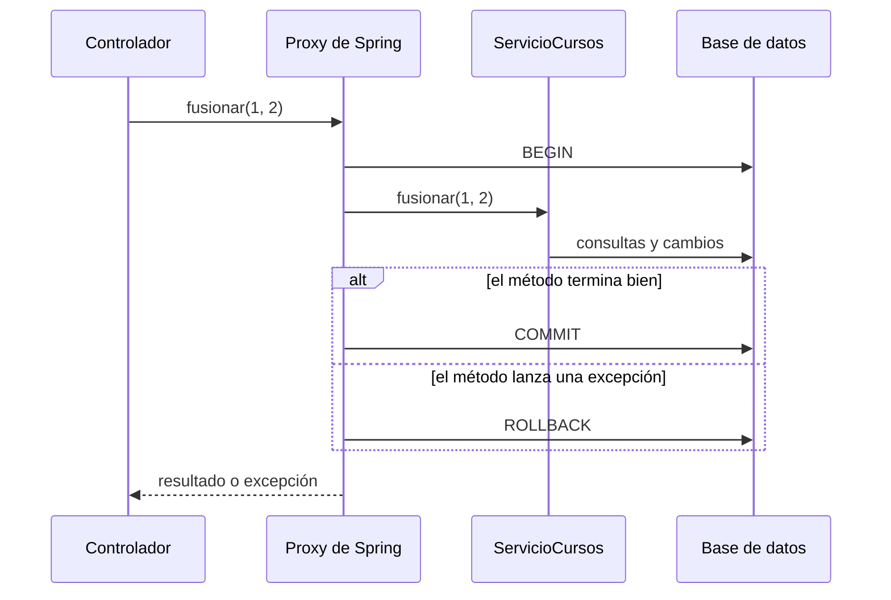

# 10. Servicios y transacciones

Hasta ahora, los controladores han llamado directamente a los repositorios. Para ejemplos pequeños
funciona, pero en cuanto una operación necesita **varios pasos** (mover alumnos de un curso a otro y
después borrar el curso) aparece una pregunta: ¿qué pasa si falla en mitad? En esta página vemos la
herramienta que lo resuelve, las **transacciones**, y la capa donde se colocan: el **servicio**.

## 10.1. La capa de servicio

En la arquitectura de capas de la Unidad 2, cada una tenía su papel:

| Capa | Responsabilidad |
|---|---|
| Controlador | Recibir la petición, validar el formulario y elegir la vista |
| **Servicio** | **Lógica de negocio**: las reglas y las operaciones completas |
| Repositorio | Acceso a los datos |

Si el controlador llama directamente a los repositorios, la lógica de negocio acaba repartida por los
controladores, repetida y difícil de probar. El servicio es el sitio donde se concentra. Además, como
veremos, es **donde se define dónde empieza y termina una transacción**.

```java
@Service
public class ServicioCursos {

    private final CursoRepository cursoRepositorio;
    private final AlumnoRepository alumnoRepositorio;

    public ServicioCursos(CursoRepository cursoRepositorio, AlumnoRepository alumnoRepositorio) {
        this.cursoRepositorio = cursoRepositorio;
        this.alumnoRepositorio = alumnoRepositorio;
    }
}
```

El controlador recibe el servicio, y no los repositorios, por inyección de dependencias.

### Excepciones propias

Cuando algo no existe, el servicio no debería depender de clases web como `ResponseStatusException`.
Se define una excepción propia, que Spring convierte en una respuesta 404:

```java
@ResponseStatus(HttpStatus.NOT_FOUND)
public class RecursoNoEncontradoException extends RuntimeException {

    public RecursoNoEncontradoException(String mensaje) {
        super(mensaje);
    }
}
```

Y se usa con `orElseThrow`, como vimos en la página de repositorios:

```java
Curso curso = cursoRepositorio.findById(id)
        .orElseThrow(() -> new RecursoNoEncontradoException("No existe el curso " + id));
```

## 10.2. Qué es una transacción

Una **transacción** es un grupo de operaciones sobre la base de datos que se tratan como **una sola
unidad indivisible**: o se completan **todas**, o no se hace **ninguna**.

Un ejemplo con nuestro modelo: **fusionar dos cursos**, pasando todos los alumnos de uno a otro y
borrando después el curso vacío. Son varios pasos:

1. Cambiar el curso de cada alumno.
2. Borrar el curso de origen.

Sin transacción, cada paso se confirma por separado. Si el programa falla entre ambos (se pierde la
conexión, salta una excepción), la base de datos queda **a medias**: algunos alumnos movidos y otros
no, o el curso borrado y los alumnos sin sitio. Con una transacción, si algo falla se **deshace todo** y
la base de datos queda exactamente como estaba.

| Término | Significado |
|---|---|
| *Commit* | Confirmar la transacción: todos los cambios se guardan definitivamente |
| *Rollback* | Deshacerla: todos los cambios se descartan |

Como vimos en la página de repositorios, cada llamada a un repositorio ya se ejecuta en su propia
transacción. El problema es que **dos llamadas seguidas son dos transacciones independientes**. Para
que varias operaciones formen una sola, necesitamos una transacción que las abarque.

## 10.3. `@Transactional`

Con Spring, se consigue anotando un método (o una clase) con `@Transactional`:

```java
import org.springframework.transaction.annotation.Transactional;

@Service
public class ServicioCursos {

    // ...

    @Transactional
    public void fusionar(Long origenId, Long destinoId) {
        Curso origen = cursoRepositorio.findById(origenId)
                .orElseThrow(() -> new RecursoNoEncontradoException("No existe el curso " + origenId));
        Curso destino = cursoRepositorio.findById(destinoId)
                .orElseThrow(() -> new RecursoNoEncontradoException("No existe el curso " + destinoId));

        for (Alumno alumno : alumnoRepositorio.findByCursoId(origenId)) {
            alumno.setCurso(destino);
        }

        cursoRepositorio.delete(origen);
    }
}
```

Spring envuelve el servicio en un objeto intermedio (un *proxy*, como el de los repositorios) que
abre la transacción antes de ejecutar el método y la cierra al terminar:



Si el método termina con normalidad, se hace *commit*; si lanza una excepción, *rollback*. Para
comprobarlo, basta con añadir temporalmente, al final del método, `throw new
IllegalStateException("Fallo simulado")`: ningún alumno cambia de curso y el curso de origen no se
borra.

:::note
Importa la anotación correcta
Existe también un `@Transactional` en el paquete `jakarta.transaction`. Spring admite ambos, pero
usa siempre el de **`org.springframework.transaction.annotation`**, que ofrece más opciones.
:::

### Cuándo se hace *rollback*

Por defecto, solo se deshace la transacción cuando el método lanza una **excepción no comprobada**
(una que hereda de `RuntimeException`, como `RecursoNoEncontradoException` o
`IllegalStateException`) o un `Error`. Si lanza una excepción **comprobada** (como `IOException`), la
transacción **se confirma igualmente**. Para cambiar esa regla:

```java
@Transactional(rollbackFor = Exception.class)
public void importar() throws IOException {
    // ...
}
```

### Los atributos más usados

| Atributo | Qué hace | Ejemplo |
|---|---|---|
| `readOnly` | Marca la transacción como de solo lectura | `@Transactional(readOnly = true)` |
| `rollbackFor` | Excepciones adicionales que provocan *rollback* | `rollbackFor = Exception.class` |
| `propagation` | Qué hace si ya hay una transacción en marcha | Por defecto, `REQUIRED`: se une a la existente, o crea una si no hay |

Con `readOnly = true`, Spring avisa a Hibernate de que no habrá modificaciones: es más eficiente y
evita escrituras accidentales. Se usa en los métodos que solo consultan.

### Anotar la clase entera

Un patrón habitual es anotar el servicio entero como de solo lectura, y marcar solo los métodos que
modifican datos con un `@Transactional` propio, que tiene prioridad:

```java
@Service
@Transactional(readOnly = true)
public class ServicioCursos {

    public List<Curso> listar() {                    // solo lectura
        return cursoRepositorio.findAllByOrderByNombreAsc();
    }

    @Transactional                                    // lectura y escritura
    public void fusionar(Long origenId, Long destinoId) {
        // ...
    }
}
```

### El contexto de persistencia y la detección de cambios

Fíjate en el método `fusionar`: cambia el curso de los alumnos con `alumno.setCurso(destino)` y **no
llama a `save`**. Aun así, los cambios se guardan. Dentro de una transacción, las entidades que se
cargan (`findById`, `findByCursoId`...) quedan **gestionadas** por Hibernate, que las vigila en una
zona de memoria llamada **contexto de persistencia**. Al hacer *commit*, compara cada entidad con
cómo la cargó y, si algo ha cambiado, genera el `UPDATE` correspondiente. A este mecanismo se le llama
**detección automática de cambios** (*dirty checking*).

Es cómodo, pero conviene tenerlo presente: **dentro de una transacción de escritura, cualquier cambio
en una entidad cargada se guarda**, aunque no se haya llamado a `save`. Y al revés, en una transacción
`readOnly` esos cambios se ignoran.

### Cuándo no funciona

`@Transactional` funciona a través del *proxy*, de modo que solo actúa cuando el método se llama
**desde otra clase**:

- Si un método de `ServicioCursos` llama a otro método **de la misma clase** que lleva
  `@Transactional`, la llamada no pasa por el *proxy* y la anotación del segundo se ignora.
- Debe estar en métodos `public` y en clases gestionadas por Spring (`@Service`...).

## 10.4. Las consultas que modifican datos

En las páginas de consultas derivadas y de `@Query` vimos que los métodos que modifican datos
(`deleteBy...`, y las consultas con `@Modifying`) necesitan una transacción activa, y la
resolvíamos anotando el método del repositorio. En una aplicación con servicios, lo normal es **no
anotar el repositorio** y hacerlo en el servicio:

```java
@Transactional
public long borrarAlumnosDeCurso(Long cursoId) {
    return alumnoRepositorio.deleteByCursoId(cursoId);     // ya se ejecuta dentro de la transacción
}
```

Aquí, `deleteByCursoId` es un método derivado declarado en el repositorio
(`long deleteByCursoId(Long cursoId);`), sin ninguna anotación. Se une a la transacción del servicio, y
esa operación puede combinarse con otras en un mismo *commit* o *rollback*.

## 10.5. `LazyInitializationException`

En la página anterior vimos que los datos relacionados con carga perezosa (`LAZY`) se cargan al
usarse por primera vez, pero **solo si la conexión sigue abierta**. Esa conexión (el contexto de
persistencia) vive lo que dura la transacción. Cuando termina, las entidades quedan **separadas**
(*detached*) y ya no pueden cargar nada más.

### Cómo reproducirlo

En el componente de pruebas de la página de repositorios (el del `@PostConstruct`), que no se
ejecuta dentro de ninguna petición web:

```java
Curso curso = cursoRepositorio.findById(1L).orElseThrow();
System.out.println(curso.getAlumnos().size());      // LazyInitializationException
```

El repositorio abre y cierra su transacción dentro de `findById`. Cuando llega la línea siguiente, el
`Curso` está separado, su lista de alumnos no se había cargado y ya no hay forma de hacerlo:

```text
LazyInitializationException: failed to lazily initialize a collection of role:
Curso.alumnos: could not initialize proxy - no Session
```

### Cómo evitarla

| Solución | Cómo |
|---|---|
| **Trabajar dentro de la transacción** | Hacer el trabajo en un método de servicio con `@Transactional`, de modo que los datos perezosos se usen mientras la transacción sigue abierta |
| **Pedir los datos en la consulta** | `join fetch` o `@EntityGraph`, vistos en la página anterior |
| **Devolver datos ya preparados** | Convertir dentro del servicio las entidades en clases propias (DTO), que no dependen de la conexión (apartado 10.6) |

Y lo que **no** hay que hacer:

- Poner todas las relaciones en `EAGER` para que desaparezca el error: trae datos que no se necesitan y
  multiplica las consultas.
- Activar `spring.jpa.properties.hibernate.enable_lazy_load_no_trans=true`: hace que cada acceso
  perezoso abra una conexión nueva, y es una fuente segura de problemas de rendimiento.

### `open-in-view`: por qué en las plantillas no fallaba

En las páginas web, la excepción no aparecía porque Spring Boot, por defecto, mantiene la conexión
abierta **durante toda la petición**, también mientras Thymeleaf genera la página
(`spring.jpa.open-in-view=true`). Gracias a eso, una plantilla puede recorrer `curso.alumnos` y
cargarlo sobre la marcha.

Es cómodo, pero tiene inconvenientes: oculta los problemas de N+1 consultas (se lanzan consultas desde
la plantilla, sin que el servicio lo sepa) y mantiene una conexión de la base de datos ocupada hasta que
se termina de generar la página. Por eso, al arrancar, Spring Boot muestra un aviso sobre ello, y es
habitual desactivarlo en proyectos reales:

```properties
spring.jpa.open-in-view=false
```

Con esa línea, las plantillas dejan de poder cargar datos perezosos, y el servicio debe devolver al
controlador **todo lo que la vista necesita ya cargado**. En esta unidad lo dejamos activado, pero
conviene probar a desactivarlo para ver qué plantillas fallan y cómo se arreglan con `join fetch` o
con DTO.

## 10.6. Entidades y DTO

Hasta ahora, los formularios y las plantillas han trabajado directamente con las entidades. Es lo más
sencillo, pero a medida que el modelo se complica, empieza a dar problemas. Un **DTO** (*Data Transfer
Object*) es una clase sencilla, sin anotaciones de JPA, que solo transporta datos entre capas.

### Un DTO para el formulario

| Problema al usar la entidad en el formulario | Con una clase propia |
|---|---|
| El formulario podría enviar un `id` (o cualquier otro atributo) y sobrescribir datos, como vimos en el *binding* | La clase solo tiene los campos que el formulario debe poder cambiar |
| `curso` es un `Curso`, pero el formulario envía un identificador | La clase tiene un `cursoId` |
| Hay campos que no pertenecen a la entidad (repetir contraseña) | Se pueden añadir sin tocar la entidad |
| Las anotaciones de validación y las de JPA se mezclan | Las validaciones van en la clase del formulario |

```java
public class AlumnoForm {

    @NotBlank(message = "El nombre es obligatorio")
    @Size(min = 2, max = 50, message = "El nombre debe tener entre 2 y 50 caracteres")
    private String nombre;

    @NotNull(message = "Debes elegir un curso")
    private Long cursoId;

    @NotNull(message = "La edad es obligatoria")
    @Min(value = 16, message = "La edad mínima es 16 años")
    private Integer edad;

    // resto de campos, constructor vacío, getters y setters
}
```

Observa que **no tiene `id`**: en la edición, el identificador viene de la ruta
(`/alumnos/{id}/editar`) y no del formulario, de modo que nadie puede cambiarlo.

En la plantilla, el `<select>` guarda el identificador del curso elegido:

```html
<select th:field="*{cursoId}">
    <option value="">-- Elige un curso --</option>
    <option th:each="curso : ${cursos}" th:value="${curso.id}" th:text="${curso.nombre}">1DAW</option>
</select>
```

Es el servicio quien convierte el formulario en una entidad, buscando el curso por su identificador:

```java
@Transactional
public Alumno crear(AlumnoForm form) {
    Curso curso = cursoRepositorio.findById(form.getCursoId())
            .orElseThrow(() -> new RecursoNoEncontradoException("No existe el curso " + form.getCursoId()));

    Alumno alumno = new Alumno();
    copiar(form, alumno, curso);
    return alumnoRepositorio.save(alumno);
}

@Transactional
public Alumno actualizar(Long id, AlumnoForm form) {
    Alumno alumno = alumnoRepositorio.findById(id)
            .orElseThrow(() -> new RecursoNoEncontradoException("No existe el alumno " + id));
    Curso curso = cursoRepositorio.findById(form.getCursoId())
            .orElseThrow(() -> new RecursoNoEncontradoException("No existe el curso " + form.getCursoId()));

    copiar(form, alumno, curso);      // sin save: la transacción detecta los cambios
    return alumno;
}

private void copiar(AlumnoForm form, Alumno alumno, Curso curso) {
    alumno.setNombre(form.getNombre());
    alumno.setCurso(curso);
    alumno.setEdad(form.getEdad());
    // ...
}
```

### Un DTO para mostrar datos

Un listado rara vez necesita la entidad completa. Un `record` con solo lo que se va a mostrar, creado
directamente desde la consulta con `select new` (página de `@Query`), **evita además las excepciones
de carga perezosa**: no hay relaciones que cargar.

```java
public record AlumnoResumen(Long id, String nombre, String curso, Integer edad) { }
```

```java
@Query(value = """
        select new es.centro.miproyecto.models.AlumnoResumen(a.id, a.nombre, a.curso.nombre, a.edad)
        from Alumno a
        """,
        countQuery = "select count(a) from Alumno a")
Page<AlumnoResumen> listarResumen(Pageable pageable);
```

En la plantilla, los componentes de un `record` se leen con paréntesis: `${alumno.nombre()}`.

### Cuándo usar cada uno

| Situación | Recomendación |
|---|---|
| Aplicación pequeña, sin riesgos con el `id`, formularios que coinciden con la entidad | La entidad directamente es suficiente |
| Formularios con relaciones, campos extra o datos que no se pueden modificar | Una clase de formulario (`AlumnoForm`) |
| Listados y fichas de solo lectura | Un DTO de salida (`AlumnoResumen`), o una consulta con `join fetch` |
| Cualquier salida en JSON | Un DTO, nunca la entidad |

## 10.7. Errores habituales

| Síntoma | Causa probable | Solución |
|---|---|---|
| `LazyInitializationException` | Se accede a datos perezosos fuera de la transacción | Trabajar dentro de un método `@Transactional`, `join fetch` o DTO |
| `TransactionRequiredException` en un `deleteBy` o un `@Modifying` | Se ejecuta fuera de una transacción | Llamarlo desde un método de servicio `@Transactional` |
| `@Transactional` no tiene efecto | La llamada se hace desde la misma clase, o el método no es `public` | Mover el método a otra clase, o llamarlo desde fuera |
| No se deshacen los cambios tras una excepción | Es una excepción comprobada | Usa `rollbackFor = Exception.class`, o lanza una excepción no comprobada |
| `UnexpectedRollbackException: Transaction silently rolled back because it has been marked as rollback-only` | Un método transaccional interno lanzó una excepción que se capturó fuera, pero la transacción ya estaba marcada para *rollback* | No capturar la excepción dentro de la transacción, o usar `propagation = REQUIRES_NEW` en el método interno |
| Un cambio se guarda sin haber llamado a `save` | Detección automática de cambios en una transacción de escritura | Es el comportamiento normal; usa `readOnly` o trabaja con copias si no se desea |
| Un cambio no se guarda | La transacción es `readOnly` | Quita `readOnly` en ese método |

## 10.8. Resumen

| Concepto | Idea clave |
|---|---|
| Servicio | Contiene la lógica de negocio y delimita las transacciones |
| Transacción | Grupo de operaciones que se confirman (*commit*) o se deshacen (*rollback*) todas juntas |
| `@Transactional` | Abre la transacción antes del método y la cierra al terminar; *rollback* con excepciones no comprobadas |
| `readOnly = true` | Para consultas: más eficiente, sin escrituras accidentales |
| Contexto de persistencia | Las entidades cargadas en una transacción se vigilan; los cambios se guardan al hacer *commit* sin llamar a `save` |
| `LazyInitializationException` | Datos perezosos usados fuera de la transacción; se evita trabajando dentro, con `join fetch` o con DTO |
| `open-in-view` | Mantiene la conexión abierta durante la vista; cómodo pero oculta problemas; muchos proyectos lo desactivan |
| DTO | Clase sencilla para formularios y salidas: más seguridad, y sin dependencia de la conexión |
