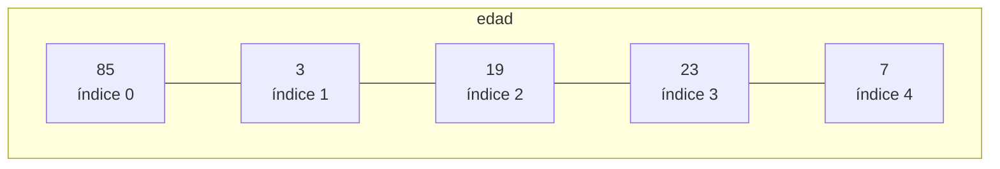

Hasta ahora, cada variable que hemos usado guardaba **un único valor**. Pero muchos problemas necesitan manejar muchos datos a la vez: las notas de una clase, las temperaturas de un mes, los nombres de los jugadores de una partida... En esta unidad vemos los **arrays** (también llamados *vectores* o *tablas*) y las **matrices**, que nos permiten guardar un conjunto de datos bajo un mismo nombre.

## Variables escalares frente a arrays

Una variable **escalar** guarda un solo dato. Si quisiéramos guardar las notas de 5 alumnos con variables escalares, tendríamos que escribir algo así:

```java
int nota1 = 7;
int nota2 = 5;
int nota3 = 9;
int nota4 = 4;
int nota5 = 8;
```

¿Y si fueran 30 alumnos? ¿Y 300? Tendríamos que declarar una variable por cada dato y no podríamos recorrerlas con un bucle.

Un **array** es un tipo de dato estructurado que permite almacenar un **conjunto de datos homogéneo**: todos del mismo tipo y relacionados entre sí. Todos los datos se guardan bajo un único nombre.

```java
int[] notas = {7, 5, 9, 4, 8};
```

:::note[Vocabulario]
- Cada dato guardado en un array se llama **elemento**.
- El número de elementos se llama **tamaño**, **longitud** o *rango* del array.
- La posición de un elemento dentro del array se llama **índice**.
- A los arrays también se les llama *vectores* o *tablas*. El término *arreglos* (traducción literal de *array*) se desaconseja.
:::

Por norma general usaremos un array cuando necesitemos manejar un conjunto de datos **del mismo tipo** que estén **relacionados entre sí**.

## Los índices

Cada elemento de un array se identifica por la posición que ocupa. Esa posición es el **índice**, y se numera **empezando por 0**: el primer elemento tiene el índice 0, el segundo el 1, y así sucesivamente.



Para usar un elemento concreto escribimos el **nombre del array** seguido del **índice entre corchetes**:

```java
int[] edad = {85, 3, 19, 23, 7};

System.out.println(edad[0]);   // 85  (el primer elemento)
System.out.println(edad[3]);   // 23
edad[4] = 8;                   // cambia el último elemento: ahora vale 8
```

:::warning[El último índice es length - 1]
Un array de 5 elementos tiene índices del **0 al 4**. No existe el elemento `edad[5]`. Es el mismo criterio que ya vimos con `charAt` en las cadenas de texto.
:::

### Índice fuera de rango

Si usamos un índice que no existe en el array (por ejemplo `edad[-1]` o `edad[20]`), el programa **se detiene en tiempo de ejecución** con una excepción:

```java
int[] edad = {85, 3, 19, 23, 7};
System.out.println(edad[5]);
```

```
Exception in thread "main" java.lang.ArrayIndexOutOfBoundsException:
Index 5 out of bounds for length 5
```

El mensaje es muy informativo: te dice **qué índice** has intentado usar y **qué longitud** tiene el array. Recuerda que el compilador no avisa de este error: solo aparece al ejecutar.

## Construcción de arrays

Para crear un array hay que seguir tres pasos:

1. Decidir **qué tipo de datos** vamos a almacenar.
2. **Declarar** un nombre para el array.
3. **Crear** el array, indicando su tamaño o sus valores.

### Declaración

Hay dos formas equivalentes de declarar un array. La segunda es la más habitual en Java:

```java
int edad[];     // tipo nombre[]
int[] edad;     // tipo[] nombre
```

Declarar un array **no lo crea**: solo reserva el nombre. Todavía no hay sitio para los datos.

### Creación con `new`

Con `new` indicamos el tipo y el **número de elementos**:

```java
int[] edad;
edad = new int[5];          // crea un array de 5 enteros

// Normalmente se hace todo en una sola línea:
double[] precios = new double[3];
String[] nombres = new String[10];
```

El tamaño puede ser una variable, lo que permite decidirlo mientras el programa se ejecuta:

```java
Scanner lector = new Scanner(System.in);
System.out.println("¿Cuántos alumnos hay?");
int numAlumnos = lector.nextInt();

double[] notas = new double[numAlumnos];
```

:::warning
Una vez creado, **el tamaño de un array no puede cambiar**. Si necesitas más espacio, hay que crear un array nuevo (lo veremos en la página de insertar y eliminar elementos).
:::

### Creación con lista de valores

Si ya conocemos los valores, podemos escribirlos entre llaves. Java calcula el tamaño por nosotros:

```java
int[] datos = {2, -3, 0, 7};                          // array de 4 elementos
String[] coches = {"Volvo", "BMW", "Ford", "Mazda"};  // array de 4 cadenas
```

Esto es equivalente a crear el array y asignar cada valor a mano:

```java
int[] datos = new int[4];
datos[0] = 2;
datos[1] = -3;
datos[2] = 0;
datos[3] = 7;
```

:::note
La lista de valores entre llaves solo puede usarse **en la misma línea en que se declara** el array. No se puede escribir `datos = {1, 2, 3};` en una línea posterior.
:::

### Valores por defecto

Cuando creamos un array con `new`, todos sus elementos se inicializan automáticamente con el valor por defecto de su tipo (el mismo que vimos para los atributos):

| Tipo de los elementos | Valor inicial |
| --- | --- |
| `byte`, `short`, `int`, `long` | `0` |
| `float`, `double` | `0.0` |
| `char` | carácter nulo `'\u0000'` |
| `boolean` | `false` |
| `String` y cualquier otro objeto | `null` |

```java
int[] a = new int[3];
System.out.println(a[0]);          // 0

String[] nombres = new String[2];
System.out.println(nombres[0]);    // null
```

## Tamaño de un array: `length`

Todo array tiene un **atributo** llamado `length` que guarda su número de elementos:

```java
int[] notas = new int[10];
System.out.println(notas.length);   // 10
```

:::warning[`length` sin paréntesis]
En un array, `length` es un **atributo**: se escribe **sin paréntesis** (`notas.length`). En una cadena de texto, `length()` es un **método** y sí lleva paréntesis (`texto.length()`). Confundirlos es un error muy frecuente.
:::

El último índice válido siempre es `length - 1`:

```java
int[] notas = {7, 5, 9, 4, 8};
System.out.println(notas[notas.length - 1]);   // 8, el último elemento
```

## Ejemplo completo: leer notas y mostrarlas

```java
import java.util.Scanner;

public class LeerNotas {
    public static void main(String[] args) {
        Scanner lector = new Scanner(System.in);
        int[] notas = new int[5];

        // Rellenar el array
        for (int i = 0; i < notas.length; i++) {
            System.out.println("Nota del alumno " + (i + 1) + ":");
            notas[i] = lector.nextInt();
        }

        // Mostrar el contenido
        for (int i = 0; i < notas.length; i++) {
            System.out.println("Alumno " + (i + 1) + ": " + notas[i]);
        }
    }
}
```

:::tip
Fíjate en que el bucle usa `i < notas.length` como condición y no un `5` fijo. Así el programa sigue funcionando si cambia el tamaño del array. Además, el alumno número `i + 1` se guarda en el índice `i`: las personas contamos desde 1, pero el array cuenta desde 0.
:::
