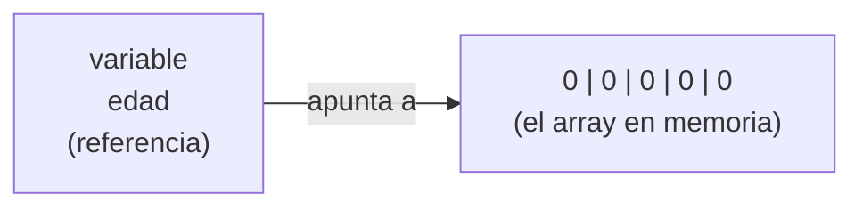
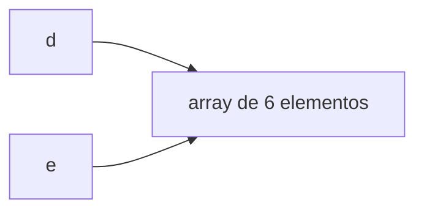

import Tabs from '@theme/Tabs';
import TabItem from '@theme/TabItem';
import CodeTrace from '@site/src/components/CodeTrace';
import trace from './traces/arrays-alias.json';

Con los tipos primitivos (`int`, `double`, `boolean`...) una variable **contiene directamente su valor**. Con los arrays no ocurre lo mismo, y entender la diferencia es imprescindible para no cometer errores muy difíciles de detectar.

## Una variable de tipo array guarda una referencia

Un array puede tener muchos elementos, así que la variable **no contiene todos los datos**: contiene la **dirección de memoria** donde está guardado el array. A esa dirección se le llama **referencia**.

```java
int[] edad = new int[5];
```



Por eso, si intentamos mostrar un array directamente con `println`, no vemos sus datos, sino algo parecido a esto:

```java
int[] vector = new int[4];
System.out.println(vector);   // [I@4617c264
```

`[I` indica que es un array de enteros (`int`) y lo que viene detrás de `@` es un identificador de su ubicación en memoria. Ese valor cambia de una ejecución a otra.

## Dos variables, un mismo array (alias)

Si asignamos una variable de tipo array a otra, **no se copian los datos**: se copia la referencia. Las dos variables acaban apuntando al **mismo array**.

```java
int[] d = new int[6];   // construimos un array referenciado por d
int[] e = d;            // e referencia el mismo array que d
```



Esto tiene una consecuencia importante: si modificamos el array a través de una variable, el cambio **se ve desde la otra**, porque es el mismo array.

<Tabs>
<TabItem value="Código" label="Código" default>
```java
int[] d = {1, 2, 3};
int[] e = d;

e[0] = 99;

System.out.println(d[0]);   // 99, ¡aunque hemos modificado e!
```
</TabItem>
<TabItem value="Demo" label="Demo" default>
    <CodeTrace trace={trace} />
</TabItem>
</Tabs>

:::warning[Asignar no es copiar]
`e = d` **no crea una copia** del array. Para obtener un array independiente con los mismos datos hay que copiarlo de verdad (con `Arrays.copyOf`, `System.arraycopy`...). Lo veremos en la página de la clase `Arrays`.
:::

## Comparar arrays: `==` frente a `equals`

El operador `==` compara las **referencias**, no el contenido. Dos arrays distintos con los mismos datos **no son iguales** para `==`:

```java
int[] t1 = {7, 5, 3, 1};
int[] t2 = {7, 5, 3, 1};

System.out.println(t1 == t2);   // false: son dos arrays distintos en memoria

int[] t3 = t1;
System.out.println(t1 == t3);   // true: es el mismo array
```

Para comparar el **contenido** se utiliza `Arrays.equals(t1, t2)`, que devuelve `true` si ambos arrays tienen la misma longitud y los mismos elementos en el mismo orden:

```java
import java.util.Arrays;
// ...
System.out.println(Arrays.equals(t1, t2));   // true
```

:::note
Es exactamente la misma situación que con las cadenas de texto: `==` compara referencias y `equals` compara contenido.
:::

## El valor `null`

Una variable de tipo array puede **no apuntar a ningún array**. En ese caso vale `null`:

```java
int[] datos;                 // declarada pero sin crear
int[] otros = null;          // no apunta a ningún array
```

Si intentamos usar un array que vale `null` (leer un elemento, consultar su `length`...), el programa se detiene con una excepción:

```java
int[] otros = null;
System.out.println(otros.length);
```

```
Exception in thread "main" java.lang.NullPointerException
```

:::tip[Cómo interpretar los dos errores más habituales]
- `ArrayIndexOutOfBoundsException`: el array **existe**, pero has pedido una posición que no tiene.
- `NullPointerException`: el array **no existe todavía** (vale `null`), así que no se puede usar. Casi siempre es que falta el `new`.
:::

## Resumen

| Concepto | Qué significa |
| --- | --- |
| Referencia | Dirección de memoria donde está el array. Es lo que guarda la variable. |
| Alias | Dos variables que apuntan al mismo array. Un cambio se ve desde ambas. |
| `==` | Compara referencias (¿es el mismo array?). |
| `Arrays.equals` | Compara contenidos (¿tienen los mismos datos?). |
| `null` | La variable no apunta a ningún array. |
