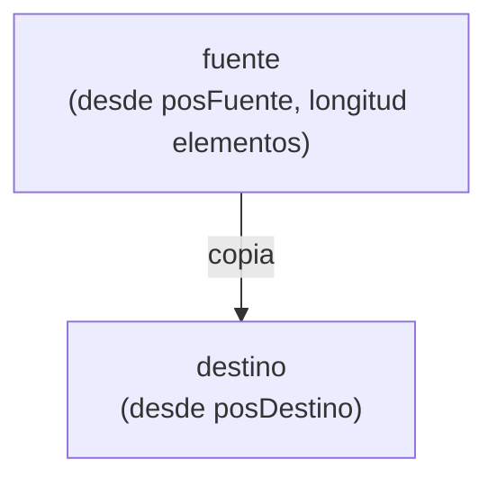

La API de Java incluye herramientas que facilitan el trabajo con arrays. Del mismo modo que usamos la clase `Math` o `Scanner`, podemos usar la clase `Arrays`, que contiene métodos estáticos para operar con ellos.

:::warning[No olvides el import]
```java
import java.util.Arrays;
```
:::

## Mostrar el contenido: `Arrays.toString`

Ya vimos que `System.out.println(array)` muestra una referencia (`[I@4617c264`) y no los datos. Podemos recorrer el array e imprimir cada elemento, pero `Arrays.toString()` lo hace por nosotros:

```java
int[] alturas = {134, 156, 190, 176, 167};
System.out.println(Arrays.toString(alturas));
```

```
[134, 156, 190, 176, 167]
```

## Rellenar: `Arrays.fill`

Asigna el mismo valor a todos los elementos:

```java
int[] contadores = new int[5];
Arrays.fill(contadores, 10);
System.out.println(Arrays.toString(contadores));   // [10, 10, 10, 10, 10]
```

## Comparar: `Arrays.equals`

Como vimos, `==` compara referencias. Para comparar el **contenido**:

```java
int[] t1 = {7, 5, 3, 1};
int[] t2 = {7, 5, 3, 1};

System.out.println(t1 == t2);                // false
System.out.println(Arrays.equals(t1, t2));   // true
```

## Ordenar: `Arrays.sort`

Ordena el array de menor a mayor, **modificando el propio array**:

```java
int[] numeros = {45, 7, 89, 12, 23};
Arrays.sort(numeros);
System.out.println(Arrays.toString(numeros));   // [7, 12, 23, 45, 89]
```

También funciona con `String` (orden alfabético):

```java
String[] nombres = {"Marta", "Álvaro", "Beatriz", "Carlos"};
Arrays.sort(nombres);
System.out.println(Arrays.toString(nombres));
```

## Buscar en un array ordenado: `Arrays.binarySearch`

Devuelve el índice donde está el valor buscado. **Solo funciona si el array está ordenado**:

```java
int[] numeros = {7, 12, 23, 45, 89};   // ya ordenado
System.out.println(Arrays.binarySearch(numeros, 23));   // 2
System.out.println(Arrays.binarySearch(numeros, 50));   // un número negativo: no está
```

:::warning
Si el valor no está, el resultado es un número **negativo** (no siempre `-1`). Si el array no está ordenado, el resultado no es fiable. Para arrays sin ordenar usa la búsqueda lineal de la página anterior.
:::

## Copiar arrays

Ya sabemos que `e = d` no copia el array, solo crea un alias. Para obtener una copia **independiente** hay tres opciones.

### `Arrays.copyOf(origen, longitud)`

Construye y devuelve una **copia nueva** del array con la longitud indicada:

```java
int[] t = {1, 2, 1, 6, 23};

int[] a = Arrays.copyOf(t, 3);
System.out.println(Arrays.toString(a));   // [1, 2, 1]

int[] b = Arrays.copyOf(t, 10);
System.out.println(Arrays.toString(b));   // [1, 2, 1, 6, 23, 0, 0, 0, 0, 0]
```

- Si la longitud es **menor** que la del original, se copian solo los primeros elementos.
- Si es **mayor**, las posiciones sobrantes se rellenan con el valor por defecto (`0`, `false`, `null`...).

Con `copyOf(t, t.length)` obtenemos una copia exacta.

### `Arrays.copyOfRange(origen, desde, hasta)`

Devuelve un array nuevo con los elementos comprendidos entre los índices `desde` (**incluido**) y `hasta` (**no incluido**):

```java
int[] t = {7, 5, 3, 1, 0, -2};
int[] a = Arrays.copyOfRange(t, 1, 4);
System.out.println(Arrays.toString(a));   // [5, 3, 1]
```

:::note[Mismo criterio que `substring`]
El límite final **no se incluye**, igual que en `substring(inicio, fin)` de las cadenas de texto.
:::

### `System.arraycopy(fuente, posFuente, destino, posDestino, longitud)`

Copia elementos de un array a otro. A diferencia de los métodos de `Arrays`, **no crea ningún array nuevo**: el array destino ya debe existir, y los elementos que haya en las posiciones copiadas **se sobrescriben**.



```java
int[] fuente = {1, 2, 3, 4, 5};
int[] destino = new int[8];

// copia 3 elementos de fuente (desde el índice 1) a destino (desde el índice 2)
System.arraycopy(fuente, 1, destino, 2, 3);

System.out.println(Arrays.toString(destino));   // [0, 0, 2, 3, 4, 0, 0, 0]
```

## Alias frente a copia

```java
int[] original = {1, 2, 3};

int[] alias = original;                          // mismo array
int[] copia = Arrays.copyOf(original, original.length);   // array independiente

original[0] = 99;

System.out.println(Arrays.toString(alias));   // [99, 2, 3]  ← ha cambiado
System.out.println(Arrays.toString(copia));   // [1, 2, 3]   ← no ha cambiado
```

## Tabla resumen

| Método | Qué hace | ¿Crea un array nuevo? |
| --- | --- | --- |
| `Arrays.toString(a)` | Devuelve el contenido como texto | No (devuelve un `String`) |
| `Arrays.fill(a, valor)` | Rellena todos los elementos con un valor | No (modifica `a`) |
| `Arrays.equals(a, b)` | Compara el contenido de dos arrays | No (devuelve `boolean`) |
| `Arrays.sort(a)` | Ordena de menor a mayor | No (modifica `a`) |
| `Arrays.binarySearch(a, valor)` | Busca un valor en un array **ordenado** | No (devuelve un índice) |
| `Arrays.copyOf(a, n)` | Copia con longitud `n` | **Sí** |
| `Arrays.copyOfRange(a, desde, hasta)` | Copia un rango de índices | **Sí** |
| `System.arraycopy(...)` | Copia elementos a un array ya existente | No (sobrescribe el destino) |
