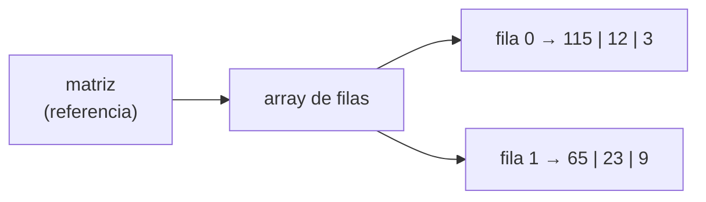

import Tabs from '@theme/Tabs';
import TabItem from '@theme/TabItem';
import CodeTrace from '@site/src/components/CodeTrace';
import trace1 from './traces/matriz-recorrido-filas.json';
import trace2 from './traces/matriz-recorrido-columnas.json';

Hasta ahora todos los arrays tenían **una sola dimensión**: bastaba un índice para localizar cualquier elemento. Pero a veces los datos se organizan de forma natural en una **tabla** con filas y columnas: las notas de varios alumnos en varias asignaturas, un tablero de ajedrez, los píxeles de una imagen... Para eso existen los arrays de más de una dimensión, y el caso más habitual es el de **dos dimensiones**: la **matriz**.

## De una a varias dimensiones

| Dimensiones | Qué necesitamos para localizar un elemento | Ejemplo |
| --- | --- | --- |
| 1 | Un índice | `edades[3]` |
| 2 | Dos índices (fila y columna) | `tablero[2][5]` |
| 3 | Tres índices | `cubo[1][4][2]` |

Una matriz de 5 filas y 5 columnas tiene este aspecto:

|  | col 0 | col 1 | col 2 | col 3 | col 4 |
| --- | --- | --- | --- | --- | --- |
| **fila 0** | 2 | 4 | 6 | 12 | 0 |
| **fila 1** | 2 | -11 | 4 | 7 | 86 |
| **fila 2** | 0 | 1 | 6 | 5 | 3 |
| **fila 3** | 1 | 93 | 6 | -2 | 0 |
| **fila 4** | 9 | 71 | 23 | 2 | 8 |

Para acceder a un elemento se escribe `matriz[fila][columna]`. Por ejemplo, en la tabla anterior `matriz[1][4]` vale `86`: fila 1, columna 4.

:::note
Los índices de fila y de columna también empiezan en 0. Y el **primer** índice siempre es la fila y el **segundo** la columna.
:::

## Declaración y creación

Se declaran igual que un array de una dimensión, pero añadiendo **un par de corchetes por cada dimensión extra**:

```java
int[][] matriz;               // declaración
matriz = new int[5][5];       // creación: 5 filas y 5 columnas
```

```java
//            filas ↓   ↓ columnas
int[][] tabla = new int[3][4];     // 3 filas y 4 columnas (12 elementos)
```

Como en los arrays normales, todos los elementos empiezan con el valor por defecto del tipo (`0` en este caso).

### Con valores iniciales

Cada fila se escribe como una lista entre llaves, y el conjunto de filas va dentro de otras llaves:

```java
int[][] matriz = {
    {2,  4,  6, 12,  0},
    {2, -11, 4,  7, 86},
    {0,  1,  6,  5,  3},
    {1, 93,  6, -2,  0},
    {9, 71, 23,  2,  8}
};
```

## Acceder y modificar elementos

```java
System.out.println(matriz[0][3]);   // 12  (fila 0, columna 3)
matriz[2][2] = 100;                 // modifica el elemento de la fila 2, columna 2
```

Igual que en una dimensión, usar una fila o columna que no existe provoca una `ArrayIndexOutOfBoundsException`.

## Tamaño de una matriz

Aquí hay un detalle importante. **Una matriz es, en realidad, un array de arrays**: la variable `matriz` apunta a un array cuyos elementos son, a su vez, referencias a otros arrays (las filas).



Por eso hay dos formas de medir:

| Expresión | Qué mide | Para `{{115, 12, 3}, {65, 23, 9}}` |
| --- | --- | --- |
| `matriz.length` | Número de arrays que contiene la matriz: el **número de filas** | `2` |
| `matriz[i].length` | Número de elementos de la fila `i`: el **número de columnas** | `3` |

```java
int[][] matriz = {{115, 12, 3}, {65, 23, 9}};

System.out.println(matriz.length);       // 2 filas
System.out.println(matriz[0].length);    // 3 columnas
```

:::warning[Cuidado con las filas y las columnas]
Es habitual confundirlas al escribir los bucles. Recuerda: `matriz.length` → filas; `matriz[0].length` → columnas.
:::

## Recorrer una matriz

Para recorrer **todos** los elementos necesitamos **dos bucles anidados**: el exterior recorre las filas y el interior recorre las columnas de cada fila.

<Tabs>
<TabItem value="Código" label="Código" default>
```java
for (int i = 0; i < matriz.length; i++) {            // filas
    for (int j = 0; j < matriz[i].length; j++) {     // columnas de la fila i
        System.out.println(matriz[i][j]);
    }
}
```
</TabItem>
<TabItem value="Demo" label="Demo" default>
    <CodeTrace trace={trace1} />
</TabItem>
</Tabs>

Si queremos mostrar la matriz con aspecto de tabla, imprimimos los elementos de una fila **en la misma línea** (`print`) y saltamos de línea al terminar cada fila (`println`):

```java
for (int i = 0; i < matriz.length; i++) {
    for (int j = 0; j < matriz[i].length; j++) {
        System.out.print(matriz[i][j] + "\t");
    }
    System.out.println();
}
```

### Recorrer en el otro sentido: por columnas

Si invertimos el orden de los bucles, el exterior recorre las columnas y el interior las filas. Solo funciona de forma sencilla si todas las filas tienen la misma longitud:

<Tabs>
<TabItem value="Código" label="Código" default>
```java
for (int j = 0; j < matriz[0].length; j++) {     // columnas
    for (int i = 0; i < matriz.length; i++) {    // filas
        System.out.println(matriz[i][j]);
    }
}
```
</TabItem>
<TabItem value="Demo" label="Demo" default>
    <CodeTrace trace={trace2} />
</TabItem>
</Tabs>

### Recorrer solo una fila o una columna

```java
int[][] matriz = {{115, 12, 3}, {65, 23, 9}};

// Solo la fila 0: la fila queda fija y varía la columna
for (int j = 0; j < matriz[0].length; j++) {
    System.out.println(matriz[0][j]);     // 115, 12, 3
}

// Solo la columna 0: la columna queda fija y varía la fila
for (int i = 0; i < matriz.length; i++) {
    System.out.println(matriz[i][0]);     // 115, 65
}
```

Fíjate: basta **un solo bucle** cuando fijamos uno de los dos índices.

### Con `for-each`

También podemos usar `for-each`: el bucle exterior recorre cada **fila** (que es un array) y el interior cada elemento de esa fila.

```java
for (int[] fila : matriz) {
    for (int valor : fila) {
        System.out.print(valor + " ");
    }
    System.out.println();
}
```

## Mostrar una matriz: `Arrays.deepToString`

`Arrays.toString` no sirve con matrices (mostraría las referencias de las filas). Para ello existe `Arrays.deepToString`:

```java
import java.util.Arrays;
// ...
int[][] matriz = {{115, 12, 3}, {65, 23, 9}};
System.out.println(Arrays.deepToString(matriz));
```

```
[[115, 12, 3], [65, 23, 9]]
```

:::note
Con matrices, la comparación de contenido se hace con `Arrays.deepEquals(m1, m2)` en lugar de `Arrays.equals`.
:::

## Matrices irregulares

Como cada fila es un array independiente, **no todas las filas tienen por qué medir lo mismo**. Es lo que se llama una matriz irregular. Se crea indicando solo el número de filas y construyendo cada fila después:

```java
int[][] triangulo = new int[4][];   // 4 filas, todavía sin crear

for (int i = 0; i < triangulo.length; i++) {
    triangulo[i] = new int[i + 1];  // la fila i tendrá i + 1 columnas
}
// fila 0: 1 elemento, fila 1: 2 elementos, fila 2: 3 elementos, fila 3: 4 elementos
```

También se pueden escribir con valores iniciales:

```java
int[][] irregular = {
    {1},
    {2, 3, 4},
    {5, 6}
};
System.out.println(irregular[1].length);   // 3
```

:::tip
En una matriz irregular **no** se puede suponer que todas las filas miden lo mismo: por eso en los bucles se usa `matriz[i].length` y no `matriz[0].length`.
:::

## Más de dos dimensiones

El mismo principio se extiende a tres o más dimensiones, añadiendo un par de corchetes por cada una. Por ejemplo, un array de tres dimensiones puede verse como un conjunto de «capas» o tablas apiladas:

```java
int[][][] cubo = new int[3][5][5];     // 3 capas de 5 filas x 5 columnas
cubo[1][4][2] = 8;                      // capa 1, fila 4, columna 2
```

En la práctica las matrices de 2 dimensiones son, con diferencia, las más utilizadas.
