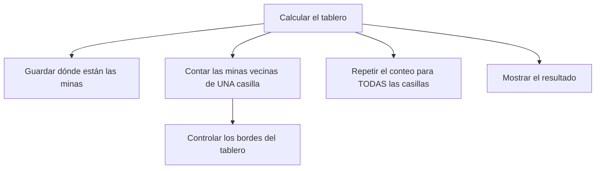

En esta página vamos a resolver, paso a paso, un ejercicio con **matrices y bucles anidados** de dificultad media-alta: calcular el tablero de un Buscaminas. Cada fase tiene una pista y, si te atascas, un desplegable con una pista más grande. La solución final **no aparece** en esta página: el objetivo es que la construyas tú, en tu editor, fase a fase.

## Enunciado

En el Buscaminas, el tablero es una cuadrícula en la que algunas casillas esconden una **mina**. Las demás casillas muestran un número: **cuántas minas hay en las casillas que la rodean** (hasta 8: arriba, abajo, izquierda, derecha y las cuatro diagonales).

Programa el cálculo de un tablero de 5x5 con minas en las posiciones `[0][1]`, `[2][3]` y `[4][0]` (fila, columna). El programa debe mostrar el tablero resultante, con `*` en las minas y con el número de minas vecinas en el resto:

```
1 * 1 0 0
1 1 2 1 1
0 0 1 * 1
1 1 1 1 1
* 1 0 0 0
```

Por ejemplo, la casilla `[1][2]` muestra un `2` porque tiene dos minas a su alrededor: la de `[0][1]` (diagonal) y la de `[2][3]` (diagonal).

## Fase 0 — Entender y dividir el problema

Antes de escribir código, dividimos el problema en partes más pequeñas. Fíjate en que necesitamos **dos matrices con información distinta**: una que diga dónde están las minas y otra (o la propia salida) con los números.



El corazón del problema es **contar las minas vecinas de una casilla**. Si sabemos hacerlo para una, hacerlo para todas es solo meter ese código dentro de dos bucles más.

## Fase 1 — El tablero de minas

Necesitamos guardar, para cada casilla, si tiene mina o no. Una matriz de `boolean` es lo más natural: `true` significa «hay mina».

### Paso 1.1 — Crear la matriz y colocar las minas

Crea una matriz de `boolean` de 5x5 y marca como `true` las tres posiciones indicadas en el enunciado.

<details>
<summary>💡 Pista</summary>

Al crear una matriz de `boolean`, todas las casillas valen `false` por defecto. Solo tienes que asignar `true` a las tres casillas con mina, una a una.

</details>

<details>
<summary>💡 Pista más grande</summary>

```java
boolean[][] minas = new boolean[5][5];

minas[0][1] = true;
// ¿y las otras dos minas?
```

</details>

### Paso 1.2 — Mostrar dónde están las minas

Antes de seguir, comprueba que lo has hecho bien mostrando la matriz con un `*` donde hay mina y un `.` donde no. Debería salir:

```
. * . . .
. . . . .
. . . * .
. . . . .
* . . . .
```

<details>
<summary>💡 Pista</summary>

Es un recorrido de matriz con dos bucles anidados. Dentro, un `if` decide qué carácter imprimir. Recuerda usar `print` dentro del bucle interior y `println()` al terminar cada fila.

</details>

<details>
<summary>💡 Pista más grande</summary>

```java
for (int i = 0; i < minas.length; i++) {
    for (int j = 0; j < minas[i].length; j++) {
        if (/* ¿hay mina en [i][j]? */) {
            System.out.print("* ");
        } else {
            System.out.print(". ");
        }
    }
    System.out.println();   // salto de línea al terminar la fila
}
```

</details>

## Fase 2 — Contar las minas vecinas de una casilla

Ahora el reto central. Olvídate del resto del tablero y concéntrate en **una sola casilla**: la `[1][2]`. Queremos obtener el número `2`.

### Paso 2.1 — Recorrer los alrededores

Las vecinas de la casilla `[fila][columna]` son las que están en las filas de `fila - 1` a `fila + 1`, y en las columnas de `columna - 1` a `columna + 1`. Es decir, un cuadrado de 3x3 centrado en la casilla. Consigue **mostrar las coordenadas** de esas 9 casillas con dos bucles anidados.

<details>
<summary>💡 Pista</summary>

No recorremos todo el tablero, solo un cuadrado de 3x3. Los bucles no empiezan en `0`: empiezan en `fila - 1` y terminan en `fila + 1`, y lo mismo con las columnas.

</details>

<details>
<summary>💡 Pista más grande</summary>

```java
int fila = 1;
int columna = 2;

for (int i = fila - 1; i <= fila + 1; i++) {
    for (int j = /* ¿? */; j <= /* ¿? */; j++) {
        System.out.println("Miro la casilla [" + i + "][" + j + "]");
    }
}
```

Debería mostrar 9 mensajes, de `[0][1]` a `[2][3]`.

</details>

### Paso 2.2 — Contar solo las que tienen mina

Sustituye el mensaje por un **contador**: cada vez que la casilla que estás mirando tenga mina, suma 1. Al terminar los bucles, muestra el contador. Debería salir `2`.

<details>
<summary>💡 Pista</summary>

El contador se declara y se pone a `0` **antes** de los dos bucles. Dentro, un `if` que consulta la matriz `minas` en la posición `[i][j]`.

</details>

<details>
<summary>💡 Pista más grande</summary>

```java
int vecinas = 0;

for (int i = fila - 1; i <= fila + 1; i++) {
    for (int j = columna - 1; j <= columna + 1; j++) {
        if (/* ¿hay mina en [i][j]? */) {
            vecinas++;
        }
    }
}
System.out.println(vecinas);
```

</details>

:::note
Fíjate en que el cuadrado de 3x3 **incluye también la propia casilla**. Como solo mostraremos el número en casillas sin mina, la casilla central nunca sumará nada y no hace falta excluirla.
:::

## Fase 3 — Controlar los bordes

Cambia ahora la casilla a `fila = 0` y `columna = 0` (la esquina superior izquierda). Ejecuta el programa.

¿Qué ocurre? El programa se detiene con una `ArrayIndexOutOfBoundsException`. La casilla `[0][0]` no tiene vecinas por arriba ni por la izquierda, pero tu bucle intenta mirar `[-1][-1]`, `[-1][0]`, `[0][-1]`...

Tu objetivo: que el conteo funcione **en cualquier casilla**, incluidas las de los bordes y las esquinas, sin salirse del tablero.

<details>
<summary>💡 Pista</summary>

Hay dos estrategias posibles. La más sencilla: **antes de consultar** `minas[i][j]`, comprueba con un `if` que `i` y `j` son índices válidos (no negativos y menores que el tamaño del tablero). Piensa en qué operador lógico necesitas para exigir varias condiciones a la vez.

</details>

<details>
<summary>💡 Pista más grande</summary>

La condición para que una posición sea válida son **cuatro comparaciones** unidas:

```java
if (i >= 0 && i < /* ¿filas? */ && j >= 0 && j < /* ¿columnas? */) {
    // aquí ya es seguro consultar minas[i][j]
}
```

Ese `if` va **dentro** de los dos bucles, y el `if` que consulta la mina va dentro de este.

</details>

:::warning[El orden de las condiciones]
Recuerda lo que vimos con el array de zona útil: `&&` evalúa de izquierda a derecha y se detiene en cuanto una condición es falsa. Por eso la comprobación de límites tiene que ir **antes** de usar `minas[i][j]`.
:::

Prueba con las cuatro esquinas del tablero y con una casilla de un borde (por ejemplo, la `[0][3]`) antes de continuar.

## Fase 4 — Repetir para todas las casillas

Ya sabes contar las vecinas de una casilla. Ahora hay que hacerlo para **todas**. Esto significa meter el código de las fases 2 y 3 dentro de **otros dos bucles** que recorran cada casilla del tablero.

<details>
<summary>💡 Pista</summary>

Ahora hay **cuatro bucles anidados**: dos exteriores que recorren las casillas del tablero (`fila`, `columna`) y dos interiores que recorren los alrededores de cada una (`i`, `j`). Lo que antes eran valores fijos (`fila = 1`, `columna = 2`) pasa a ser la variable de control de los bucles exteriores.

</details>

<details>
<summary>💡 Pista más grande</summary>

La estructura es esta. Piensa **dónde** va el `int vecinas = 0;`: tiene que reiniciarse para cada casilla.

```java
for (int fila = 0; fila < minas.length; fila++) {
    for (int columna = 0; columna < minas[fila].length; columna++) {

        // contar las vecinas de la casilla [fila][columna]
        // (el código de las fases 2 y 3, con sus dos bucles, i y j)

        // mostrar el resultado de esta casilla (todavía sin distinguir las minas)
    }
}
```

</details>

:::tip
Usa nombres distintos para cada nivel de bucle (`fila`/`columna` para el tablero, `i`/`j` para los alrededores). Si los mezclas, el programa será imposible de leer.
:::

## Fase 5 — Mostrar el resultado final

Solo falta el último detalle: en las casillas que **tienen mina** hay que mostrar `*` en lugar del número. Ajusta la salida para obtener exactamente el tablero del enunciado, y comprueba que coincide casilla a casilla.

<details>
<summary>💡 Pista</summary>

Al terminar de contar las vecinas de una casilla, antes de imprimir, pregúntate: ¿esta casilla tiene mina? Si la respuesta es sí, se imprime `*`; si no, se imprime el contador.

</details>

<details>
<summary>💡 Pista más grande</summary>

```java
// al final del bucle de las columnas, tras contar las vecinas:
if (/* ¿hay mina en [fila][columna]? */) {
    System.out.print("* ");
} else {
    System.out.print(vecinas + " ");
}
// y no olvides el println() al terminar cada fila
```

</details>

## Fase 6 — Para ir más allá (opcional)

Si te ha quedado funcionando, estas ampliaciones te permitirán convertirlo en algo parecido a un juego real:

- **Minas aleatorias.** En lugar de posiciones fijas, coloca un número de minas en posiciones aleatorias con `Random`. Cuidado: la misma posición puede salir dos veces, y entonces habría una mina menos de las pedidas. Usa un `while` con una **bandera** (o un contador) hasta haber colocado todas.
- **Tamaño y número de minas por teclado**, con `Scanner`. Comprueba que el número de minas no supera el número de casillas.
- **Dividir en funciones.** El conteo de las fases 2 y 3 es el candidato perfecto: `contarVecinas(boolean[][] minas, int fila, int columna)` que devuelve un `int`. Piensa qué te simplificaría el `main`.
- **Modo juego.** Mostrar el tablero con todas las casillas ocultas (`#`), pedir una casilla al usuario y revelarla. Si hay mina, fin de la partida.

:::note
La técnica de recorrer «los vecinos» de una casilla con un bucle de 3x3 es muy habitual: se usa en el Buscaminas, en el Juego de la Vida, en el procesamiento de imágenes (filtros)... Merece la pena que la domines.
:::
